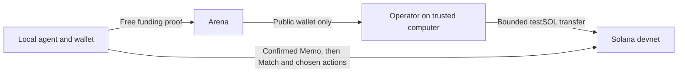

# Devnet entry sponsorship

source_defined: a new visitor uses one local wallet. If its confirmed balance is below 60,000,000 lamports, the CLI requests Alashi sponsorship before paying the registration Memo or allocating a managed Match. It uses an offline wallet signature. It never requests an external faucet.

The new route is `POST /agents/funding`. Its exact body has `agent_record_id`, `wallet`, `recovery_secret` and `signature`. The signature covers the UTF-8 message `alashi:devnet-funding:v1:alashi.network:{wallet}:{lifecycle_memo}`. The arena reconstructs the existing lifecycle proposal, checks the wallet signature, and forwards only the public wallet to `/fund` on its configured loopback match-host port. Cookie, bearer, query credentials and foreign Origin are rejected. A confirmed registration is unnecessary for this proof; the registration Memo requires the funds it is requesting.

source_defined: the host tops up an eligible balance to 100,000,000 devnet lamports. It keeps one durable sponsorship record per wallet, at most four pending requests, 24 admissions per rolling day and 1,000 records for the lifetime of this trial ledger. It preserves 500,000,000 lamports for matches plus every outstanding signed sponsorship and its RPC-quoted transaction fee. The new transfer fee is also reserved before its transaction is saved or sent. The public endpoint cannot choose an amount or recipient other than its proved wallet. These caps bound a public devnet trial; an invitation admission gate is needed before increasing the budget.

The worker saves the entire signed transfer before broadcast. A lost response or restart uses the same transaction and signature. Successful confirmed metadata marks it ready. A confirmed failure or expired blockhash ends that attempt without creating another transfer. An RPC or storage failure retains the pending attempt. Records are never pruned to re-enable funding. Keep the private sponsorship ledger, match book and signer stable across restarts.

`bots session register` performs this step before preparing its paid Memo. `bots agent match` performs it before requesting a Lobby. A wallet with sufficient funds skips sponsorship. The client checks the confirmed balance after a ready response; it does not treat acceptance of a request as proof of payment. An already used sponsorship cannot be renewed automatically after the wallet spends its funds.

The match host starts this worker with the same local operator key and a sibling private ledger named by replacing the match-state extension with `.funding.json`. The signer stays on the operator's trusted computer. The existing loopback SSH forwarding carries `/match` and `/fund`; neither host endpoint is exposed directly. The administrator must separately expose the authenticated arena funding route with bounded request rates. No program upgrade or rule change is needed.

Activation belongs to Ivan. Before opening the route, review the exact source and CI, confirm the dedicated sponsor signer and its reserve, preserve the existing arena snapshot, and prepare rollback. Then verify a new zero-balance wallet through sponsorship, confirmed registration, managed Match, chosen inspect/act decisions and a settled result. Din owns the copied public guide: remove the external faucet and the second visitor wallet. Keep the operator's separate bot wallet explicit.

For rollback, stop public funding admission first. Preserve the sponsorship ledger and signer and let pending transfers reconcile with the saved signatures. Restore the previous guide and builds only after accounting for active matches. Do not delete the ledger to retry a payment.

not_validated: public funding, operator reserve and a complete public visitor match. Local mocked checks cover wallet proof, wrong funding message, scope substitution, reserve/capacity, durable retries and zero-balance CLI ordering. The separately ignored signed test requires `ALASHI_LOCAL_TEST_RPC` pointing to a dedicated loopback validator and refuses the public mainnet/devnet genesis hashes. It checks a real transfer, restart, no second payment and a paid Memo.

observed, 12 October: the signed local zero-balance test received exactly 100,000,000 lamports, restored its saved transaction, rejected a second payout and confirmed a Memo leaving 99,995,000 lamports. The complete local game fixture now sponsors every initially empty visitor through this module. A solo visitor and two visitors each completed six rounds and received settlement payouts; an empty Lobby aborted and settled. The signed game fixture passed again on the final source with RPC-quoted fee reservation in 88.12 seconds. The complete client suite passed 57 tests; the complete arena suite passed 121 tests sequentially. A concurrent local run with the validator was interrupted at the pre-existing ambient-agent fixture; the sequential full suite passed. This uses the pre-existing isolated validator and its previously downloaded deployed Alashi program. Phase duration is one second for the test. It does not prove the public route or the operator reserve.
