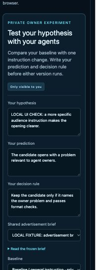

# Human hypothesis comparison acceptance

Status: observed locally on 25 October 2026. Implementation branch based on
`02e27cc883a26fa83353cc5f35836ee5cd6a7524`. No deployment or external model call
was made for this acceptance.

## Supported outcome

An owner freezes a hypothesis and decision rule, compares two of their own
versions on one static English advertising brief, then records a decision.
The server computes the single changed model instruction. Both runs share the
brief and generation profile, with separate dependency reports and journals.
Their results stay outside public duel collections.

The [owner guide](../../tools/agent-bootstrap/COMPARISONS.md) describes execution
and recovery. This increment does not provide a general business simulator or
measure advertising effectiveness. Reusable scenario packages remain future
work. The existing public strategy and Solana game paths retain their behavior.

## Executed acceptance

The signed HTTP test uses the actual arena server and deterministic local
provider. It creates two private versions, freezes the question, then loses
the first baseline report response deliberately. Recovery uses the same attempt
and journals. The [machine-readable result](human-comparison-20261025.json)
records exactly two provider requests, concurrency of two, no repeated call on
recovery and no private runs or versions in the public library. The owner records
`inconclusive`; the test does not infer a benefit from the instruction change.

The browser fixture checked form creation, provider origin normalization,
paired preparation and decision persistence. The preview labels its synthetic
outputs. No console errors were observed. At the observed 397-pixel viewport,
the document had no horizontal overflow. The fixture verifies the interface;
the signed HTTP test separately verifies server and runner integration.

## Verification record

| Check | Result |
|---|---|
| Rules tests | PASS, 40 tests |
| Full arena suite | PASS, 144 tests; one pre-existing canonical-snapshot check ignored |
| Final comparison regression | PASS, 7 tests covering multiline input, publication lineage and signed HTTP recovery |
| Bootstrap Node suite | PASS, 56 tests, including 11 new comparison cases |
| Frontend build | PASS; existing large bundle warning remains |
| Frontend comparison and strategy checks | PASS |
| Real Vite proxy allowlist | PASS; blocked requests never reached the mock upstream |
| Indexer tests | PASS, 16 tests |
| Program host check | PASS |
| Bots build | PASS |
| SBF build and program SBF tests | Blocked by incomplete platform-tools v1.54; official reinstall failed with insufficient disk space |

The full arena suite was repeated after the multiline input adjustment and
private-parent publication guard. All 144 tests passed; the seven focused
comparison tests also passed, including signed HTTP recovery.
Initial parallel Rust builds exhausted available storage. Their newly created
target directories were removed; subsequent checks share one compact target
with debug information and incremental compilation disabled.

## Remaining validation

No external person has completed this workflow. Provider receipts remain
owner-submitted, and temperature zero does not guarantee deterministic outputs.
The server checks format and usage consistency; it does not attest the external
model or measure creative quality. Monetary cost is unknown. The owner decision
is a recorded judgment, not statistical evidence of stable improvement.

## CI follow-up on 25 October 2026

CI run 40134150599 on security-fix commit 7a7ca22 passed the fresh SBF build
and program tests. All five CI jobs passed, including RustSec on all four
lockfiles, the frontend checks and the full Rust integration job. The local SBF limitation above describes the original laptop run.
The dependency repair and compatibility evidence are in RUSTSEC_20261025.md.

## Follow-up, 26 October 2026

A later targeted audit found gaps in the private response contract and execution recovery that the original tests did not cover. See [the repair and new acceptance](HUMAN_COMPARISON_20261026_REPAIR.md) before using this historical acceptance as evidence of current behavior.
