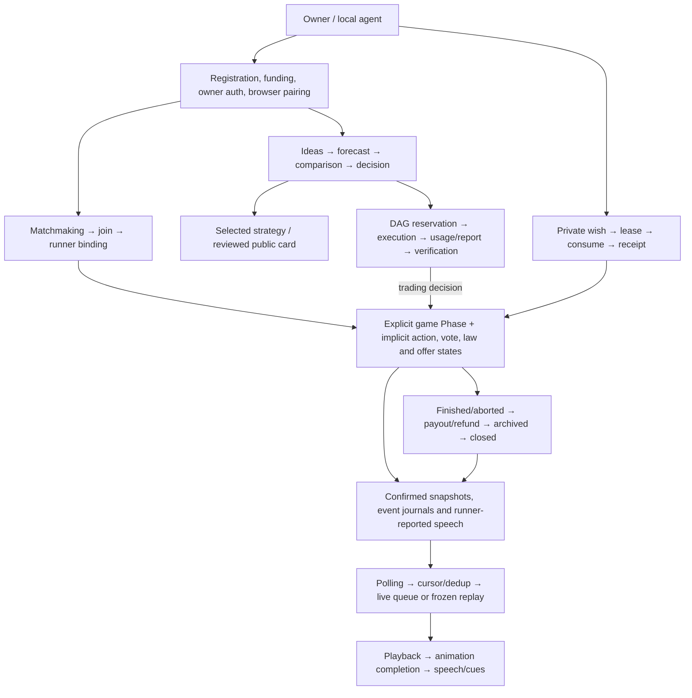
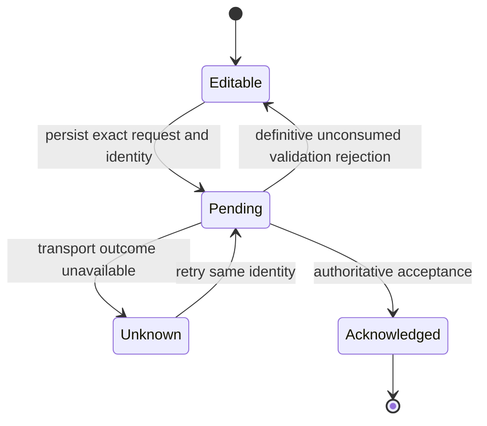

# ALASHI implicit state machines

Audit date: 7 November 2026. `source_defined` inventory, with static failure paths separately labelled. No application code was changed.

Follow-up work started in the Git checkout on branch `codex/implicit-state-fixes-20261107`, based on `7113b9af`. The inventory below preserves the original audit. Current reproduction and repair results are recorded in the [follow-up evidence](state-machines-20261107/README.md).

After the owner authorized fixes for 6 and 7, both viewer boundaries received tested repairs. Their [separate repair report](state-machines-20261107/fixes-6-7/README.md) records RED/GREEN, real-renderer browser evidence and mandatory Rust/SBF checks. Findings 3, 5 and 8 remain unchanged.

ALASHI has an explicit game phase enum, but most surrounding lifecycles are encoded by combinations of optional records, flags, timestamps, request IDs, maps and file existence. This inventory contains 126 entries across the codebase: 46 frontend/companion families, 38 arena families, 18 rules/onchain families and 24 runner/service families. The 18 core entries include the already explicit Phase skeleton and its implicit deadline state. The count is an inventory of implementation-level lifecycles, not 126 independent business processes: browser/server peers and nested machines intentionally appear separately.

Each detailed row records its state representation, transitions, guards and source references. Reconstructed names such as “terminal_unarchived” describe states the code already permits; they are not existing enum members.

| Area | Entries | Inventory |
|---|---:|---|
| Browser identity, owner controls, feeds, live/replay, research UI, rendering, mock graph and companion prototype | FE01-FE46 | [Frontend inventory](IMPLICIT_STATE_MACHINES_20261107_FRONTEND.md) |
| HTTP admission, auth/pairing, wish delivery, dialogue, strategy/comparison/research, persistence and harnesses | A01-A38 | [Arena inventory](IMPLICIT_STATE_MACHINES_20261107_ARENA.md) |
| Account/configuration, explicit phase, action allowance, law/voting, debt/protection/customs, auction/barter, settlement and donkey randomness | C01-C18 | [Rules and onchain inventory](IMPLICIT_STATE_MACHINES_20261107_CORE.md) |
| Registration/transaction journals, bot turns, funding/match host, dialogue, indexer/archive, local scheduler/experiments and oracle operator | S01-S24 | [Runner and service inventory](IMPLICIT_STATE_MACHINES_20261107_SUPPORT.md) |

## Boundaries most worth testing

These are observed code paths and inferred consequences. None was exercised through a browser, RPC or transport-failure harness in this audit. Existing intentional fail-closed states are described separately below.

| Order | Trigger and resulting state | Source evidence | Useful acceptance probe |
|---:|---|---|---|
| 1 | Rust HTTP CLI saves `{"action":"produe"}` as pending. Server returns `bad_action` with `op_consumed:false`; retry repeats it, while corrected `produce` is blocked by the local pending-action guard. | [bots/src/session_cli.rs:888,899,907,928](../../bots/src/session_cli.rs#L888); [arena/src/api.rs:2184](../../arena/src/api.rs#L2184). Node counterpart already clears the three definitive unconsumed validation errors at [tools/agent-bootstrap/alashi.mjs:307](../../tools/agent-bootstrap/alashi.mjs#L307). Independently traced by two reviewers. | Reject a typo, then successfully submit a corrected action at the same operation ID. Retain pending state for transport uncertainty. |
| 2 | Terminal snapshot archive write fails once. The cache still latches `terminal=true`; subsequent requests bypass archive forever while that entry remains resident. Closing safely stalls as `not_archived`. Eviction/restart permits retry. | [indexer/src/chain_api.rs:128,160,179,221](../../indexer/src/chain_api.rs#L128); [bots/src/close_settled.rs:60](../../bots/src/close_settled.rs#L60). Independently traced by two reviewers. | Fail the first write, restore storage, read the same cached game, and verify archival retries without restarting. |
| 3 | A faction uses Produce/Shuttle then buys roof protection in the same Action. `roof` writes the action stamp but does not reject an already-spent stamp. The reverse order rejects Produce/Shuttle. | [rules/src/actions.rs:163,179,303,338](../../rules/src/actions.rs#L163); [rules/src/sim.rs:148](../../rules/src/sim.rs#L148); [programs/alashi/src/instructions/epoch90s.rs:103](../../programs/alashi/src/instructions/epoch90s.rs#L103). | Check both action orders against the intended one-action rule and decide whether roof is explicitly an exception. |
| 4 | HTTP wish consumption commits but its response is lost. Agent injects the wish only after successful acknowledgement; consumed wishes no longer get claimed. | [arena/src/wishes.rs:478](../../arena/src/wishes.rs#L478); [arena/src/bin/agent.rs:834](../../arena/src/bin/agent.rs#L834). Chain wish counterpart has idempotent consume responses at [arena/src/chain_wishes.rs:853](../../arena/src/chain_wishes.rs#L853). | Drop the successful consume response and prove the same wish can be reconciled without double execution or silent loss. |
| 5 | Open a forecast round and receive zero forecasts. Comparison start is blocked, closing needs at least one forecast, and no cancel/deadline transition exists. | [arena/src/strategy_research.rs:160,386,459](../../arena/src/strategy_research.rs#L160); [arena/src/strategy_comparison.rs:416](../../arena/src/strategy_comparison.rs#L416). | Define and verify owner cancellation or expiry for an unanswered roster. This may require an explicit product decision. |
| 6 | Feature-gated HTTP `/stream` starts an action, then its 3D boundary fails. The callback that clears the active action cannot fire; later actions remain queued and reactions suppressed. | [frontend/src/live/StreamPage.tsx:31,75,81,122](../../frontend/src/live/StreamPage.tsx#L31). Devnet viewer already has a completion watchdog at [frontend/src/devnet/DevnetPage.tsx:156](../../frontend/src/devnet/DevnetPage.tsx#L156). | Fail the child renderer mid-action, then deliver another event and verify scheduler recovery while text history survives. |
| 7 | Legacy HTTP viewer/companion switches game or source while reactions remain queued. Cursor resets, but queue and delayed result callback retain old-game work. | [frontend/src/feed.ts:77](../../frontend/src/feed.ts#L77); [frontend/src/events.ts:41](../../frontend/src/events.ts#L41); [frontend/src/App.tsx:49](../../frontend/src/App.tsx#L49); [frontend/companion/web/Companion.tsx:178](../../frontend/companion/web/Companion.tsx#L178). | Switch A → B/off before A queue drains; no old caption or reaction should appear afterward. |
| 8 | Eight unfulfillable barter offers occupy the whole offer pool. Acceptance is the only removal; no cancellation/expiry exists. Persistence across rounds is intentional. | [rules/src/actions.rs:88,120](../../rules/src/actions.rs#L88); [rules/src/constants.rs:12](../../rules/src/constants.rs#L12). | Fill with offers no participant can accept, then verify the intended recovery/cancel policy. |
| 9 | Donkey runner resumes after the resolution transaction has fallen outside the newest 20 game signatures. Its durable pending entry may never find a resolution. | [bots/src/main.rs:1496,1536](../../bots/src/main.rs#L1496). | Resume against longer history and recover the exact round/faction resolution without authorizing another paid attempt. |

## Model these distinctions before refactoring

The most useful explicit boundaries are owner authentication/private delivery (FE03-FE05, A07-A16), transaction/executor journals (S01-S04, S09-S14, S19-S21), comparison execution (A20-A29), and viewer scheduling (FE07-FE16). A discriminated union plus a transition function is enough for many of them; the audit does not establish a need for a new state-machine library.

This request diagram applies to the HTTP operation journal. A new signed Solana transaction or model call has stricter rules: an ambiguous effect must be reconciled, not recreated under a new identity. Preserve those distinctions when sharing code.

Several apparent errors are deliberate states:

- HTTP settlement failure quarantines malformed legacy games. Crank skips them and no HTTP recovery transition exists; the invariant is fail-closed, not “every Finished game is paid.”
- Strategy `running` spans waiting for opponent, executable tasks, expired admission, and awaiting a receipt. Deadline and progress need separate axes. Late reporting can be legitimate.
- `usage_unknown` cannot be repaired by changing an immutable receipt; a comparison may end inconclusive. An executor must expose that terminal outcome.
- Registration and dialogue journals intentionally stop after uncertain signing. Some recovery is explicitly manual.
- `Faction.is_president` is not current authority; `Game.president` is. `alive` has no production elimination/revival lifecycle in the reviewed core, and unused pending fields are not active machines.
- Timed action-stage tables and the donkey viewer projection already model states explicitly. Numeric balances, immutable configuration, pure rendering geometry and ordinary isolated UI toggles are not independently counted.

## Version, coverage and verification

Selected local root: `/Users/amir/Downloads/alashi-main`. It is an unpacked copy with no `.git`. GitHub connection verified [Jakisheff/alashi main at 7113b9af330a9bce90b35919fdb37a4d3d20f230](https://github.com/Jakisheff/alashi/commit/7113b9af330a9bce90b35919fdb37a4d3d20f230).

Compared Git blob hashes for 208 selected source/client-test/static-entry files: 206 match that commit exactly. `frontend/src/Onboarding.tsx` and `frontend/src/strategies/Page.tsx` differ only in copy/markup; transition code is unchanged. No files are missing in the compared source directories. References in the detailed inventory use local source line numbers, so the local files are the primary navigation target. [Hash manifest](IMPLICIT_STATE_MACHINES_20261107_SOURCES.json) records per-file local and remote hashes.

Reviewed entry points, state structures, mutation writers, guards and callers in frontend/src, frontend/companion, arena/src, rules/src, programs/alashi/src, bots/src, indexer/src, agent-bootstrap runtime and donkey operator scripts. Read selected tests/specs to distinguish intended behavior from missing transitions. Legacy HTTP, feature-gated stream, offline `/live`, mock `/graph`, companion and simulation harnesses are labelled in their inventories. Public standalone HTML has no executable scripts. Generated code, dependencies, asset geometry, archived research/experiments, data fixtures, statistical utilities and deployment/build pipelines are outside this application-runtime catalog.

The inventory is a bounded static audit, not a proof of every possible interleaving or a statement about current deployment flags. It covers the application workflow families found in those scopes. Five existing Node test files were attempted: alashi, strategy-run, strategy-scheduler, strategy-comparison and local-experiment. All five stopped at module loading because `@solana/web3.js` is absent; no behavioral test executed. [Test output](IMPLICIT_STATE_MACHINES_20261107_TESTS.log).

No full Rust/SBF build, browser acceptance, mutation/CRAP/duplication gate, real provider request or live transaction was run. No application source change required a regression gate. Runtime failure injection and acceptance probes above remain unperformed. Work products are this report, its detailed inventories, hash/test evidence, and progress-log entries; no commit, push or deployment was performed from the unpacked copy.

Completed at 07.11 11:15 (Asia/Almaty). Факт: 0.17 часов.
