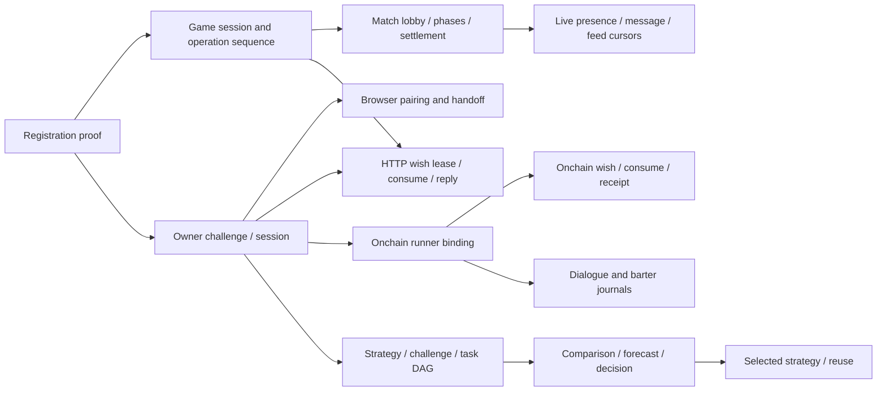

# ALASHI arena state-machine inventory

Scope: static audit of `/Users/amir/Downloads/alashi-main/arena/src`, including the HTTP agent executable and its live client. Source references below are repository-relative. No service was started, no live game or RPC was called, and no source was changed. Tests mentioned below were read, not executed by this audit agent.

A machine is counted when history, a deadline, or a previous event changes the legal next operations. Some domains already have enums; their leases, receipts, counters, and persistence compose additional implicit states. Pure configuration choices and arithmetic accumulators are not each counted as separate lifecycle machines.

## Primary inventory

| ID | Machine and encoding | States, events, guards | Source / consumers |
|---|---|---|---|
| A01 | HTTP game admission and managed lobby. `games`, `managed_match`, `faction_count`, `phase_ends_at`, `agents`. | Absent -> empty lobby -> underfilled lobby -> ready lobby -> running. `/match` returns an existing joined game, chooses a joinable lobby, waits while the managed lobby closes, or creates one. Reaching `MIN_FACTIONS` shortens managed lobby deadline to at most 30 seconds; full/deadline starts if enough players; late underfilled lobby is removed. | [arena/src/api.rs:1277](../../arena/src/api.rs#L1277), [arena/src/api.rs:1628](../../arena/src/api.rs#L1628), [arena/src/api.rs:2679](../../arena/src/api.rs#L2679), [arena/src/api.rs:1005](../../arena/src/api.rs#L1005). `/match`, `/game/{id}/join-v2`, background crank. |
| A02 | HTTP phase deadline/grace overlay around explicit rules `Phase`. | Active phase -> nominal deadline passed but grace still open -> crank eligible -> next phase. Crank and `/advance` wait until `phase_ends_at + grace_s`; normal actions have no wall-clock cutoff in `h_act_inner` and continue to use the stored phase until advancement. Messaging deliberately closes at the nominal deadline. Phase identity includes round, phase, deadline. | [arena/src/api.rs:1005](../../arena/src/api.rs#L1005), [arena/src/api.rs:2279](../../arena/src/api.rs#L2279), [arena/src/api.rs:2557](../../arena/src/api.rs#L2557); [arena/src/live.rs:226](../../arena/src/live.rs#L226), [arena/src/live.rs:430](../../arena/src/live.rs#L430). Core phase transitions belong to the rules audit. |
| A03 | HTTP settlement, archival and quarantine. `Phase::Finished`, `settlement_error`, `games`, `completed`, `completed_replay`. | Finished/unsettled -> settlement planning -> archived result + removed active game. Rules error -> persisted Finished/quarantined; storage error -> rollback/retry. Archive eviction eventually removes old results and their replay windows. | [arena/src/api.rs:847](../../arena/src/api.rs#L847), [arena/src/api.rs:1033](../../arena/src/api.rs#L1033), [arena/src/api.rs:1985](../../arena/src/api.rs#L1985). `/state` switches response shape from `state` to `finished/result`. |
| A04 | Registration proof lifecycle. Proposal-key presence, `RegisteredAgent.receipt: Option`, registry membership. | No proposal key -> durable key; deterministic proposal -> external Memo transaction -> unconfirmed proof -> verified receipt in registry. Same proof retries return the saved receipt; another signature/wallet/secret conflicts. RPC verification runs outside the transaction lock and is rechecked before commit. Proposal itself is stateless, so requesting it does not consume registry capacity. | [arena/src/api.rs:1432](../../arena/src/api.rs#L1432), [arena/src/api.rs:1467](../../arena/src/api.rs#L1467), [arena/src/api.rs:1537](../../arena/src/api.rs#L1537); `arena/src/registration.rs`. Used by funding, joining, owner authentication. Legacy per-game registration at [arena/src/api.rs:1727](../../arena/src/api.rs#L1727) is a separate compatibility path. |
| A05 | HTTP game bearer lifecycle/recovery. `AgentRec.token`, `session_expires_at`, `recovery_hash`, registration presence. | Not joined -> authenticated join -> valid bearer -> expired bearer; recovery rotates bearer and renews expiry while preserving operation sequence. Legacy bearer recovery has its own enrollment rules and may lack TTL. | [arena/src/api.rs:685](../../arena/src/api.rs#L685), [arena/src/api.rs:1636](../../arena/src/api.rs#L1636), [arena/src/api.rs:1759](../../arena/src/api.rs#L1759), [arena/src/api.rs:1822](../../arena/src/api.rs#L1822). Action, game-message, wish endpoints consume the bearer. |
| A06 | Ordered action idempotency. `OpState.last`, `recent`, body hash; completed replay sessions. | Next ID -> validated but unconsumed / executed and consumed -> cached retry. Same ID/different body -> conflict; skipped ID -> out-of-order; old evicted ID -> stale. Consumption persists even for a domain action failure once an action log exists. Completed games replay old consumed actions but reject new actions. | [arena/src/api.rs:111](../../arena/src/api.rs#L111), [arena/src/api.rs:2090](../../arena/src/api.rs#L2090), [arena/src/api.rs:2119](../../arena/src/api.rs#L2119), [arena/src/api.rs:2230](../../arena/src/api.rs#L2230); [arena/src/bin/agent.rs:1105](../../arena/src/bin/agent.rs#L1105). |
| A07 | Owner wallet challenge. `used_at`, expiry, challenge map, rolling attempt history. | Absent -> issued -> signature verified -> consumed; expiry/replacement invalidates; rate-limited until rolling window clears. One fresh challenge replaces prior challenge for that record. | [arena/src/owner_auth.rs:23](../../arena/src/owner_auth.rs#L23), [arena/src/owner_auth.rs:631](../../arena/src/owner_auth.rs#L631), [arena/src/owner_auth.rs:640](../../arena/src/owner_auth.rs#L640), [arena/src/owner_auth.rs:722](../../arena/src/owner_auth.rs#L722). Browser and CLI auth wrappers use the same challenge. |
| A08 | Owner session authorization. `revoked_at`, expiry, record-wallet binding. | Active -> revoked / expired / invalid because current registration no longer matches. Login mints session; restore checks it; logout writes revocation. Browser TTL is seven days; CLI owner TTL is 30 minutes. | [arena/src/owner_auth.rs:36](../../arena/src/owner_auth.rs#L36), [arena/src/owner_auth.rs:801](../../arena/src/owner_auth.rs#L801), [arena/src/owner_auth.rs:863](../../arena/src/owner_auth.rs#L863), [arena/src/owner_auth.rs:870](../../arena/src/owner_auth.rs#L870), [arena/src/owner_auth.rs:905](../../arena/src/owner_auth.rs#L905). Owner wishes, strategy, research, pairing. |
| A09 | Browser pairing. Nullable identity/game/faction, `completed_at`, `redeemed_at`, grant/browser hashes. | Waiting -> runner-bound completed -> browser-redeemed; expiry invalidates. Completion requires owner bearer and exact faction binding. Polling redemption uses a deterministic session token derived from browser nonce, so a lost cookie response can be retried. New pairing replaces the same browser's old grant. | [arena/src/owner_auth.rs:62](../../arena/src/owner_auth.rs#L62), [arena/src/owner_auth.rs:143](../../arena/src/owner_auth.rs#L143), [arena/src/owner_auth.rs:213](../../arena/src/owner_auth.rs#L213), [arena/src/owner_auth.rs:307](../../arena/src/owner_auth.rs#L307). Client starts -> local runner completes -> browser polls. |
| A10 | One-use owner handoff link, coupled to pairing. `used_at`, expiry, optional `pairing_grant_hash`. | Issued -> redeemed -> consumed, or expired/replaced. Redeem checks record, wallet, game, live/recoverable binding, and pairing not already redeemed; consumption plus owner session commit atomically. Pairing poll and fallback-link redemption compete to consume the same pairing. | [arena/src/owner_auth.rs:47](../../arena/src/owner_auth.rs#L47), [arena/src/owner_auth.rs:441](../../arena/src/owner_auth.rs#L441), [arena/src/owner_auth.rs:517](../../arena/src/owner_auth.rs#L517); [arena/src/chain_wishes.rs:148](../../arena/src/chain_wishes.rs#L148). |
| A11 | Live bearer/presence. `LiveSession` contains token expiry, heartbeat lease, ambient-reply flag. | No session -> valid/offline -> present while lease active -> offline on heartbeat timeout; token expiry/revoke disables writes. Session rotation resets presence; server reload clears heartbeat leases to avoid showing stale presence. Reply opt-in affects who can reply to the host's ambient posts. | [arena/src/live.rs:31](../../arena/src/live.rs#L31), [arena/src/live.rs:104](../../arena/src/live.rs#L104), [arena/src/live.rs:156](../../arena/src/live.rs#L156), [arena/src/live.rs:188](../../arena/src/live.rs#L188), [arena/src/live.rs:604](../../arena/src/live.rs#L604), [arena/src/live.rs:707](../../arena/src/live.rs#L707). |
| A12 | Live message admission, reply graph and quota. Receipt map + request hash + prior messages + current phase. | Unsubmitted -> committed/receipt cached; exact retry returns receipt; changed retry conflicts. New game messages require current phase identity before deadline; reply needs existing parent, ambient foreign-host reply requires opt-in and a host parent. Rate limit and per-phase/game/day budget form waiting/exhausted states. | [arena/src/live.rs:299](../../arena/src/live.rs#L299), especially [arena/src/live.rs:422](../../arena/src/live.rs#L422), [arena/src/live.rs:438](../../arena/src/live.rs#L438), [arena/src/live.rs:496](../../arena/src/live.rs#L496). `game_message` and `ambient_message` share it. |
| A13 | Event feed retention and cursor synchronization. `next_seq`, prune watermarks, memberships. | Initial cursor -> paging -> caught up; cursor ahead invalid; cursor older than retained watermark expired; initial history may be truncated. Joining adds game-room membership; writes prune old messages/receipts while active-game events are retained. | [arena/src/live.rs:19](../../arena/src/live.rs#L19), [arena/src/live.rs:57](../../arena/src/live.rs#L57), [arena/src/live.rs:218](../../arena/src/live.rs#L218), [arena/src/live.rs:604](../../arena/src/live.rs#L604). Public game and personal feeds. |
| A14 | HTTP owner wish delivery. Explicit `WishStatus` plus implicit lease and one-consumption guard. | Received/unleased -> leased -> Consumed -> Replied/Declined/Expired. Leased Received/Deferred can become Deferred/Declined/Expired; expired lease can be reclaimed. Consumed never redelivers. Game termination expires Received, Deferred, and Consumed. Accepted-per-game quota and idempotency key are separate irreversible admission state. | [arena/src/wishes.rs:19](../../arena/src/wishes.rs#L19), [arena/src/wishes.rs:37](../../arena/src/wishes.rs#L37), [arena/src/wishes.rs:121](../../arena/src/wishes.rs#L121), [arena/src/wishes.rs:174](../../arena/src/wishes.rs#L174), [arena/src/wishes.rs:340](../../arena/src/wishes.rs#L340), [arena/src/wishes.rs:440](../../arena/src/wishes.rs#L440). Owner submit/read, agent claim/status. |
| A15 | Onchain runner binding/presence. Binding-map membership, rotating token, `last_seen_at`, game/faction liveness. | Unbound -> verified active binding -> stale presence after five minutes -> renewed by claim/rebind. Binding can be rotated; existing terminal binding may rebind receipt-only if a Consumed/Unconfirmed wish still needs a receipt. Owner handoff may restore a settled faction even after runner stops. | [arena/src/chain_wishes.rs:25](../../arena/src/chain_wishes.rs#L25), [arena/src/chain_wishes.rs:141](../../arena/src/chain_wishes.rs#L141), [arena/src/chain_wishes.rs:148](../../arena/src/chain_wishes.rs#L148), [arena/src/chain_wishes.rs:233](../../arena/src/chain_wishes.rs#L233), [arena/src/chain_wishes.rs:380](../../arena/src/chain_wishes.rs#L380), [arena/src/chain_wishes.rs:705](../../arena/src/chain_wishes.rs#L705). Note token authorization itself compares token hash; five-minute liveness is a separate admission/presentation condition. |
| A16 | Onchain wish execution/receipt. Explicit `ChainStatus` plus lease, consumed-slot baseline and nullable receipt fields. | Received/Deferred -> leased -> Consumed -> Confirmed or Unconfirmed; Unconfirmed -> Confirmed. Consumed can Decline/Expire. Confirmation requires matching event after consumed slot, exact intent/faction/game, signature and slot. Terminal reconciliation expires only unconsumed wishes, preserving uncertain submitted outcomes. Same Consumed/Unconfirmed/Confirmed retries are idempotent. | [arena/src/chain_wishes.rs:35](../../arena/src/chain_wishes.rs#L35), [arena/src/chain_wishes.rs:59](../../arena/src/chain_wishes.rs#L59), [arena/src/chain_wishes.rs:451](../../arena/src/chain_wishes.rs#L451), [arena/src/chain_wishes.rs:600](../../arena/src/chain_wishes.rs#L600), [arena/src/chain_wishes.rs:626](../../arena/src/chain_wishes.rs#L626), [arena/src/chain_wishes.rs:705](../../arena/src/chain_wishes.rs#L705), [arena/src/chain_wishes.rs:816](../../arena/src/chain_wishes.rs#L816). |
| A17 | Confirmed barter conversation journal. Entry kinds, receipt links, `in_reply_to`, idempotency map. | No journal/offer -> recorded offer -> accepted-confirmed response or counterparty's declined-rule response. Accepted event can backfill missing offer. Confirmed branches require complete indexed history and exact transaction events; declines are runner assertions with limited rule codes. Duplicate receipt events or contradictory duplicate response IDs are rejected. | [arena/src/chain_conversations.rs:27](../../arena/src/chain_conversations.rs#L27), [arena/src/chain_conversations.rs:48](../../arena/src/chain_conversations.rs#L48), [arena/src/chain_conversations.rs:320](../../arena/src/chain_conversations.rs#L320), [arena/src/chain_conversations.rs:610](../../arena/src/chain_conversations.rs#L610). This projects barter history; it does not change the onchain offer's actual state. |
| A18 | Onchain public speech admission. Current expected phase tuple + journal parent graph + per-author counters/time. | New speech -> committed -> retry receipt; wrong phase/deadline becomes stale, wrong reply direction/unknown offer invalid, five-second throttle or four-per-phase/24-per-game quota blocks. Historical speech is runner-reported, never a confirmed-text transaction. | [arena/src/chain_dialogue.rs:14](../../arena/src/chain_dialogue.rs#L14), [arena/src/chain_dialogue.rs:77](../../arena/src/chain_dialogue.rs#L77), [arena/src/chain_dialogue.rs:180](../../arena/src/chain_dialogue.rs#L180), [arena/src/chain_dialogue.rs:225](../../arena/src/chain_dialogue.rs#L225), [arena/src/chain_dialogue.rs:380](../../arena/src/chain_dialogue.rs#L380). |
| A19 | Strategy version lineage/publication. `published`, parent reference, immutable content digest. | Private root/derivative -> published; child visibility constrained by parent visibility; public is irreversible through this API. Entering a duel with a private derivative is blocked until publication; the separate private-comparison workflow can use the owner's private derivative. Same content create is idempotent; publish is a separate transition. | [arena/src/strategy_cycle.rs:27](../../arena/src/strategy_cycle.rs#L27), [arena/src/strategy_cycle.rs:36](../../arena/src/strategy_cycle.rs#L36), [arena/src/strategy_cycle.rs:761](../../arena/src/strategy_cycle.rs#L761), [arena/src/strategy_cycle.rs:812](../../arena/src/strategy_cycle.rs#L812), [arena/src/strategy_cycle.rs:835](../../arena/src/strategy_cycle.rs#L835). |
| A20 | Duel admission, shared start clock, result reveal. Challenge `started_at`, participant count, run results. | Empty -> first seat/waiting -> second seat/clock started -> deadline reached or both completed -> results revealed. A run is already stored as `running` while waiting for the opponent. Trading deadline is capped at captured game phase end. | [arena/src/strategy_cycle.rs:61](../../arena/src/strategy_cycle.rs#L61), [arena/src/strategy_cycle.rs:563](../../arena/src/strategy_cycle.rs#L563), [arena/src/strategy_cycle.rs:835](../../arena/src/strategy_cycle.rs#L835), [arena/src/strategy_cycle.rs:998](../../arena/src/strategy_cycle.rs#L998). |
| A21 | Per-task DAG execution claim and budget reservation. Call map, `execution_id`, status strings, usage/report fields. | Dependency-blocked -> eligible -> reserved by one executor -> reported or failed. No report usage -> uncertain, retains budget; known usage consumes measured tokens. Reserving requires all dependencies passed, time remaining, a running/certain run, and known+held+new <= budget. Exact same claim retry allowed; competing executor rejected. Reports are immutable once recorded. | [arena/src/strategy_cycle.rs:97](../../arena/src/strategy_cycle.rs#L97), [arena/src/strategy_cycle.rs:157](../../arena/src/strategy_cycle.rs#L157), [arena/src/strategy_cycle.rs:960](../../arena/src/strategy_cycle.rs#L960), [arena/src/strategy_cycle.rs:1065](../../arena/src/strategy_cycle.rs#L1065). Shared by duel and private comparison endpoints. |
| A22 | Strategy run outcome and verification. String status + derived calls + optional result. | Running -> budget_overrun / usage_unknown / quality_failed, or all tasks passed -> completed. Precedence is budget overrun, unknown usage, quality failure, otherwise running. Nontrading completion requires every plan task passing; trading completion additionally requires actual game receipt. Deadline is orthogonal and does not itself rewrite status. | [arena/src/strategy_cycle.rs:133](../../arena/src/strategy_cycle.rs#L133), [arena/src/strategy_cycle.rs:1111](../../arena/src/strategy_cycle.rs#L1111), [arena/src/strategy_cycle.rs:1175](../../arena/src/strategy_cycle.rs#L1175), [arena/src/strategy_cycle.rs:1338](../../arena/src/strategy_cycle.rs#L1338); reload validation at [arena/src/strategy_cycle.rs:376](../../arena/src/strategy_cycle.rs#L376). |
| A23 | Host review. Optional `Review`, reveal state, owner identity. | Completed/unreviewed -> accepted or rejected; immutable retry only. Must be revealed, host must be distinct from contestant, and trading runs reject reviews because they use game receipts. | [arena/src/strategy_cycle.rs:125](../../arena/src/strategy_cycle.rs#L125), [arena/src/strategy_cycle.rs:1193](../../arena/src/strategy_cycle.rs#L1193), [arena/src/strategy_cycle.rs:183](../../arena/src/strategy_cycle.rs#L183). |
| A24 | Strategy trade execution/attestation. Captured context, passed deliver artifact, result receipt. | Captured trading challenge -> fully verified decision -> prepare -> actual HTTP/onchain action -> receipt-confirmed completion. HTTP action atomically updates game and strategy; failure marks quality_failed. Onchain receipt may arrive later but receipt confirmation time must be after deliver and within deadline. Receipt reuse is rejected. | [arena/src/strategy_trade.rs:17](../../arena/src/strategy_trade.rs#L17), [arena/src/strategy_trade.rs:65](../../arena/src/strategy_trade.rs#L65), [arena/src/strategy_trade.rs:139](../../arena/src/strategy_trade.rs#L139), [arena/src/strategy_trade.rs:224](../../arena/src/strategy_trade.rs#L224), [arena/src/strategy_trade.rs:271](../../arena/src/strategy_trade.rs#L271), [arena/src/strategy_trade.rs:381](../../arena/src/strategy_trade.rs#L381); [arena/src/strategy_cycle.rs:1249](../../arena/src/strategy_cycle.rs#L1249), [arena/src/strategy_cycle.rs:1273](../../arena/src/strategy_cycle.rs#L1273), [arena/src/strategy_cycle.rs:1303](../../arena/src/strategy_cycle.rs#L1303), [arena/src/strategy_cycle.rs:1338](../../arena/src/strategy_cycle.rs#L1338), [arena/src/strategy_cycle.rs:1416](../../arena/src/strategy_cycle.rs#L1416). |
| A25 | Private comparison attempt and decision. Attempts vector, baseline/candidate `Run`, optional decision. | Comparison frozen -> attempt started with paired runs -> runs finish/stop/expire -> owner decision (adopt/keep/inconclusive) -> frozen. Open forecast blocks start. Any reserved task blocks decision, even past deadline; unknown usage only permits inconclusive. After decision only exact report/finish retries are allowed. Attempt limit bounds new attempts. | [arena/src/strategy_comparison.rs:61](../../arena/src/strategy_comparison.rs#L61), [arena/src/strategy_comparison.rs:72](../../arena/src/strategy_comparison.rs#L72), [arena/src/strategy_comparison.rs:321](../../arena/src/strategy_comparison.rs#L321), [arena/src/strategy_comparison.rs:416](../../arena/src/strategy_comparison.rs#L416), [arena/src/strategy_comparison.rs:486](../../arena/src/strategy_comparison.rs#L486), [arena/src/strategy_comparison.rs:568](../../arena/src/strategy_comparison.rs#L568). |
| A26 | Forecast collection. Participants set, forecast map, `closed_at`. | Absent -> open for fixed roster -> immutable per-owner predictions -> closed. Cannot open after comparison started; needs at least one prediction to close; close releases comparison-start guard. No deadline/cancel transition is present. | [arena/src/strategy_research.rs:40](../../arena/src/strategy_research.rs#L40), [arena/src/strategy_research.rs:160](../../arena/src/strategy_research.rs#L160), [arena/src/strategy_research.rs:386](../../arena/src/strategy_research.rs#L386), [arena/src/strategy_research.rs:426](../../arena/src/strategy_research.rs#L426), [arena/src/strategy_research.rs:459](../../arena/src/strategy_research.rs#L459). |
| A27 | Research backlog and applied strategy selection. Priority, optional comparison/source, per-record `Applied`. | Backlog later <-> now; may attach comparison. Decided non-inconclusive attempt -> selected version for future runs; later apply replaces selection. Existing run retries retain original version even after selection changes. Reusing a library card creates a later-priority backlog item with provenance. | [arena/src/strategy_research.rs:18](../../arena/src/strategy_research.rs#L18), [arena/src/strategy_research.rs:49](../../arena/src/strategy_research.rs#L49), [arena/src/strategy_research.rs:133](../../arena/src/strategy_research.rs#L133), [arena/src/strategy_research.rs:335](../../arena/src/strategy_research.rs#L335), [arena/src/strategy_research.rs:501](../../arena/src/strategy_research.rs#L501), [arena/src/strategy_research.rs:595](../../arena/src/strategy_research.rs#L595); [arena/src/strategy_cycle.rs:853](../../arena/src/strategy_cycle.rs#L853). |
| A28 | Mechanism-card publication. Card-map membership/content ID/consent. | Local result or decided comparison -> published immutable card. Requires consent and fixed license; a retry changing publication content conflicts. No retract/edit operation. | [arena/src/strategy_research.rs:57](../../arena/src/strategy_research.rs#L57), [arena/src/strategy_research.rs:69](../../arena/src/strategy_research.rs#L69), [arena/src/strategy_research.rs:527](../../arena/src/strategy_research.rs#L527). |
| A29 | Research digest read/unread. Day + content fingerprint + acknowledgement. | No content -> read/inactive; new content or new day -> unread; exact day/fingerprint acknowledgement -> read; changes immediately make old ACK stale. | [arena/src/strategy_research.rs:81](../../arena/src/strategy_research.rs#L81), [arena/src/strategy_research.rs:201](../../arena/src/strategy_research.rs#L201), [arena/src/strategy_research.rs:256](../../arena/src/strategy_research.rs#L256), [arena/src/strategy_research.rs:477](../../arena/src/strategy_research.rs#L477). |
| A30 | HTTP agent turn lifecycle. `Mem`, phase tuple, observed faction flags, local model/action result. | Polling -> decision needed -> optional wish lease/consume -> decide -> act -> success or fallback -> wait for phase. Reset `Mem` when round/phase changes. One post-vote veto review allowed; inspect/bid flags prevent repeated attempts. Finished -> report -> optional ambient idle -> exit; absolute run timeout exits. | [arena/src/bin/agent.rs:374](../../arena/src/bin/agent.rs#L374), [arena/src/bin/agent.rs:381](../../arena/src/bin/agent.rs#L381), [arena/src/bin/agent.rs:636](../../arena/src/bin/agent.rs#L636), [arena/src/bin/agent.rs:739](../../arena/src/bin/agent.rs#L739), [arena/src/bin/agent.rs:775](../../arena/src/bin/agent.rs#L775), [arena/src/bin/agent.rs:945](../../arena/src/bin/agent.rs#L945). |
| A31 | HTTP agent uncertain action delivery. Local op ID and retained exact body. | Ready -> request sent -> result known, or response lost -> same-body/same-ID retry -> known result or stop uncertain. Advance counter only when server explicitly reports consumption. A conflicting/malformed op response exits without fallback. | [arena/src/bin/agent.rs:950](../../arena/src/bin/agent.rs#L950), [arena/src/bin/agent.rs:1007](../../arena/src/bin/agent.rs#L1007), [arena/src/bin/agent.rs:1105](../../arena/src/bin/agent.rs#L1105). Server peer is A06. |
| A32 | HTTP agent public/ambient reply scheduler. Cursor, pending list, attempted message IDs, last-attempt times, call counters. | Opted out / live opened -> poll addressed posts -> pending while same phase -> eligible under budget/deadline -> model reply/post -> attempted or skipped. Game reply budget four model calls and 20-second spacing; ambient mode max three calls and 300 seconds. Cursor advances on receipt of a page, not successful reply. | [arena/src/bin/agent.rs:600](../../arena/src/bin/agent.rs#L600), [arena/src/bin/agent.rs:706](../../arena/src/bin/agent.rs#L706), [arena/src/bin/agent.rs:749](../../arena/src/bin/agent.rs#L749), [arena/src/bin/agent.rs:1153](../../arena/src/bin/agent.rs#L1153), [arena/src/bin/agent.rs:1218](../../arena/src/bin/agent.rs#L1218); [arena/src/bin/agent/live_client.rs:130](../../arena/src/bin/agent/live_client.rs#L130). |

## Shared and auxiliary machines

These are additional control-flow machines rather than separate player-facing domains.

| ID | Machine | Encoding / transitions / location |
|---|---|---|
| A33 | Durable mutation transaction | Committed snapshot -> lock/clone -> provisional mutation -> write temporary file -> sync -> rename -> committed; any write failure -> in-memory rollback. Startup missing snapshot permits clean development start; malformed snapshot copies evidence and refuses startup. Canonical mode additionally requires existing proposal key and sequence. [arena/src/api.rs:238](../../arena/src/api.rs#L238), [arena/src/api.rs:244](../../arena/src/api.rs#L244), [arena/src/api.rs:324](../../arena/src/api.rs#L324), [arena/src/api.rs:3532](../../arena/src/api.rs#L3532), [arena/src/api.rs:3555](../../arena/src/api.rs#L3555); shared strategy mutation helper [arena/src/strategy_cycle.rs:536](../../arena/src/strategy_cycle.rs#L536). |
| A34 | Bounded request permits and long polling | Permit free -> acquired -> automatically released on drop; acquisition refused at limits. Long-poll request waits for phase tuple change, game removal, or deadline. [arena/src/api.rs:2010](../../arena/src/api.rs#L2010), [arena/src/api.rs:3495](../../arena/src/api.rs#L3495), [arena/src/api.rs:3507](../../arena/src/api.rs#L3507); registration verification shares permit mechanism. |
| A35 | HTTP request framing | Request line -> bounded unique headers -> empty-line terminator -> exact Content-Length body -> request ready; invalid framing/timeout -> rejection and connection close. Nullable seen headers encode already-seen guards. [arena/src/http.rs:19](../../arena/src/http.rs#L19), [arena/src/http.rs:50](../../arena/src/http.rs#L50). |
| A36 | Simulation runner phase orchestration | Explicit rules phase chooses strategy callbacks, but local order implicitly enforces collect decisions -> execute -> veto review -> close phase -> log -> next virtual clock -> settle. Sequential/lottery/batch are configuration, not lifecycle states. [arena/src/runner.rs:237](../../arena/src/runner.rs#L237). |
| A37 | Tactical/genome one-shot bribe allowance | `bribes` count increments when selecting a bribe, before result is known; exhausted allowance blocks future selection for that strategy instance. [arena/src/strategies.rs:173](../../arena/src/strategies.rs#L173), [arena/src/strategies.rs:265](../../arena/src/strategies.rs#L265), [arena/src/strategies.rs:351](../../arena/src/strategies.rs#L351), [arena/src/strategies.rs:404](../../arena/src/strategies.rs#L404). These are simulation strategies, not the onchain bot runner. |
| A38 | Evaluation harness request/response | External subject: observation emitted -> await stdin action -> parse or fallback -> emit decision -> next game callback. [arena/src/bin/evalgame.rs:81](../../arena/src/bin/evalgame.rs#L81). The evolution loop is an algorithmic generation/selection loop (`arena/src/evoagents.rs:131`), not a persisted app workflow. |

The match/funding proxy ([arena/src/chain_match.rs:14](../../arena/src/chain_match.rs#L14), [arena/src/chain_match.rs:47](../../arena/src/chain_match.rs#L47)) validates downstream `preparing -> assigned/ready` responses but stores no independent match state. Root's bot/match-host audit owns that machine. `rating.rs` derives continuous numeric ratings; RNG state is not separately listed as a lifecycle. `presidency.rs`, `simrun`, and `role_oracle` are scenario/research harnesses reusing the explicit game machine. `api_*tests.rs` and embedded tests provide evidence, not additional production workflows.

## Transition boundaries that deserve explicit names or tests

1. Finished but quarantined is a real fourth terminal outcome. `settle_and_record_locked` persists `settlement_error` ([arena/src/api.rs:860](../../arena/src/api.rs#L860)); crank skips it ([arena/src/api.rs:1033](../../arena/src/api.rs#L1033)); `/advance` first calls `sim.advance` ([arena/src/api.rs:2590](../../arena/src/api.rs#L2590)), and [rules/src/transitions.rs:403](../../rules/src/transitions.rs#L403) rejects Finished. There is no HTTP recovery transition. This is an intentional fail-closed quarantine for malformed legacy state, evidenced by [arena/src/api_tests.rs:198](../../arena/src/api_tests.rs#L198), not proof that ordinary games hit it. It should be named separately from archived/paid/finished in diagrams and tooling.

2. HTTP wish consume acknowledgement can be lost. Server [arena/src/wishes.rs:478](../../arena/src/wishes.rs#L478) has no same-status idempotent success branch. Agent [arena/src/bin/agent.rs:834](../../arena/src/bin/agent.rs#L834) only injects the wish after the consumed response succeeds. Therefore the static failure path is: consume commits -> response lost -> agent does not inject -> future claims exclude Consumed -> no re-delivery, later game expiry. This consequence is a code-supported failure hypothesis, not a runtime reproduction. The chain variant already returns successful retries at [arena/src/chain_wishes.rs:853](../../arena/src/chain_wishes.rs#L853).

3. A forecast roster can keep a comparison blocked indefinitely. Open round blocks comparison start ([arena/src/strategy_research.rs:160](../../arena/src/strategy_research.rs#L160)); close requires nonempty forecasts ([arena/src/strategy_research.rs:466](../../arena/src/strategy_research.rs#L466)); action dispatch has no cancellation/deadline/roster replacement. If no participant ever submits, the owner cannot run that comparison. Static reachability verified; whether the missing cancel is a bug or a deliberate product rule needs an acceptance decision.

4. `running` is not sufficient to drive a strategy UI. It also means waiting for opponent, expired with no reservations, fully verified but awaiting a game receipt, or no work currently executable. Deadline checks block new reservations ([arena/src/strategy_cycle.rs:998](../../arena/src/strategy_cycle.rs#L998)) but reporting and nontrading `finish_run` do not require completion before deadline ([arena/src/strategy_cycle.rs:1065](../../arena/src/strategy_cycle.rs#L1065), [arena/src/strategy_cycle.rs:1175](../../arena/src/strategy_cycle.rs#L1175)). Treat the clock as an orthogonal state. No claim that late reporting is incorrect; late receipts can be deliberate.

5. Unknown usage is terminal for that task receipt. An initial report without `usage` changes call to reported/failed; any later report with filled usage conflicts with immutable report equality ([arena/src/strategy_cycle.rs:1111](../../arena/src/strategy_cycle.rs#L1111)). Run becomes `usage_unknown`, and no more tasks reserve. The owner's comparison can record only inconclusive after all reservations resolve ([arena/src/strategy_comparison.rs:321](../../arena/src/strategy_comparison.rs#L321)). This fail-closed behavior should be visible to executors; it is not recoverable merely by resending enriched receipt data.

6. One-use auth flows differ in retry guarantees. Pairing poll reconstructs the same session after a lost cookie response ([arena/src/owner_auth.rs:366](../../arena/src/owner_auth.rs#L366)); signature challenge finish and handoff redemption mark used and issue a random session ([arena/src/owner_auth.rs:722](../../arena/src/owner_auth.rs#L722), [arena/src/owner_auth.rs:517](../../arena/src/owner_auth.rs#L517)). A lost successful response requires a fresh challenge/handoff; blindly retrying the same input cannot recover it. This is an observed protocol property, not an authentication vulnerability.

7. Composite-state validation lives at multiple boundaries. Strategy call/run fields, browser pairing nullable fields, wish lease/status/receipt fields and game/session maps can represent combinations the handlers forbid. Reload validators cover many constraints; only the sum of handlers, validators and clocks defines the legal machine. Refactoring one enum alone would not capture these lifecycles.

## Verification and coverage limits

Read handlers and their callers, followed API routing in `api.rs`, inspected state shapes and mutation/reload guards, and read relevant persistence/settlement tests. The exact core Finished guard was independently confirmed by the rules audit agent. No new tests or full build were run for this read-only inventory. Runtime concurrency, transport-failure injection, deployment configuration and UI acceptance are not established by this static pass. Coverage is the named source directories and active handler families, not a mathematical proof of all possible program states.
