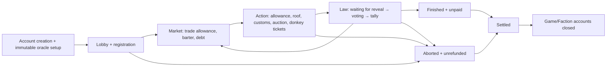

# ALASHI rules and onchain state inventory

Scope: `/Users/amir/Downloads/alashi-main/rules/src` and `/Users/amir/Downloads/alashi-main/programs/alashi/src`, read-only source audit. Entry points were checked in [programs/alashi/src/lib.rs:26](../../programs/alashi/src/lib.rs#L26), simulator callers in [rules/src/sim.rs:22](../../rules/src/sim.rs#L22), and relevant tests/specifications. No code was changed and no runtime, SBF, live service or transaction checks were run. Findings below describe the selected source, not deployed account state.

There are 17 implicit workflow machines below, plus the existing explicit phase machine and its implicit deadline substate. These are grouped by independent lifecycle; individual numeric balances and immutable execution-mode settings are not counted as separate machines. Several machines share the same Game/Faction records.

## Inventory

| ID | Machine and encoding | Actual transitions and guards | Source anchors |
|---|---|---|---|
| C01 | Registration and configuration freeze. Account absence, `phase`, `faction_count`, faction PDA existence, `vote_weight_mode`. | `initialize` creates an empty Lobby; `join` atomically transfers entry fee and creates a faction, then increments count. One faction PDA per wallet/game; maximum six. `set_vote_mode` remains mutable by admin while Lobby; leaving Lobby freezes it. Insufficient membership waits until deadline, then aborts. Epoch 2 also requires oracle setup before the first fee. Lobby deadline is an advance condition, not a join rejection. | [programs/alashi/src/instructions/initialize.rs:20](../../programs/alashi/src/instructions/initialize.rs#L20); `join.rs:27`; `set_vote_mode.rs:19`; [rules/src/transitions.rs:117](../../rules/src/transitions.rs#L117); [rules/src/sim.rs:39](../../rules/src/sim.rs#L39). |
| C02 | Existing explicit phase machine, with an implicit timed substate. `Phase` + `round` + `phase_ends_at` + wall clock. | Explicit: Lobby → Market → Action → Law → next-round Market or Finished; insufficient Lobby or VRF outage → Aborted. Within each phase, `before deadline` → `eligible for advance`; a crank must actually advance it. Six-member Lobby can start early. Final round is six. Finished/Aborted reject further advance. Actions generally check phase, not wall clock, so they can still happen after deadline before a crank changes phase. | [rules/src/state.rs:8](../../rules/src/state.rs#L8); [rules/src/transitions.rs:116](../../rules/src/transitions.rs#L116), `:371`, `:403`, `:414`; [programs/alashi/src/instructions/advance.rs:187](../../programs/alashi/src/instructions/advance.rs#L187); [rules/src/sim.rs:63](../../rules/src/sim.rs#L63). |
| C03 | Per-faction action allowance. `acted_stamp == ((round << 3) | phase)` means spent; inequality means available. | Market buy/sell/credit sale and Action produce/shuttle/bribe/donkey consume allowance. Phase/round change implicitly resets it without clearing the field. Contribution-weight voting additionally interprets lack of the current round's Action stamp as skipping Action. Most service operations do not consume it. Roof writes the stamp but lacks the corresponding already-acted guard, an asymmetry described below. | [rules/src/state.rs:105](../../rules/src/state.rs#L105); [rules/src/actions.rs:14](../../rules/src/actions.rs#L14), `:57`, `:163`, `:179`, `:198`, `:222`, `:266`, `:303`; [rules/src/transitions.rs:287](../../rules/src/transitions.rs#L287). |
| C04 | Ballot participation. `voted_stamp`, `vote`, current stamp, law availability, `alive`. | Uncast → cast once by `vote`; no vote until a law is revealed. Accepting a vote-sale offer also marks the seller cast. Round/phase change makes the old stamp inactive. Tally only includes alive factions with the current Law stamp; Abstain remains a cast vote but contributes no yes/no weight. | [rules/src/actions.rs:433](../../rules/src/actions.rs#L433); [rules/src/actions.rs:524](../../rules/src/actions.rs#L524); [rules/src/transitions.rs:282](../../rules/src/transitions.rs#L282); [rules/src/logic.rs:279](../../rules/src/logic.rs#L279). |
| C05 | Law randomness/reveal and waiting budget. `entropy_mode`, `law_card == NO_LAW`, `vrf_account`, `commit_slot`, `vrf_retries`, `phase_ends_at`. | Slot-hash mode draws during Action → Law. VRF mode commits and enters Law without a card; validated reveal makes it voteable. Law advance before reveal waits, then extends deadline up to the retry limit, then Aborted. These are repeated waiting windows for the same commitment, not new oracle requests. Retry counter is initialized once and is not reset on successful reveal or later round. Epoch-2 uncommitted Action has an additional 30-second grace → abort path. | [rules/src/transitions.rs:46](../../rules/src/transitions.rs#L46), `:105`, `:229`, `:262`, `:466`; [programs/alashi/src/instructions/initialize.rs:81](../../programs/alashi/src/instructions/initialize.rs#L81); `advance.rs:193`; `reveal_law.rs:274`; `docs/SPEC_VRF.md:5`. |
| C06 | Presidency and veto. `game.president`, faction influence/alive, `veto_pending`; separate stale `faction.is_president`. | Action close elects current leader, then reveals/commits law. During a revealed Law, that wallet may move veto from available to pending once. Tally turns pending veto into a blocked yes-majority; phase exit clears pending. President persists into next round's customs decision until next election. `Faction.is_president` is only set true when exercising a veto and never maintained by elections, so it is not the authoritative current-president state. | [rules/src/transitions.rs:151](../../rules/src/transitions.rs#L151), `:313`, `:392`, `:418`; [rules/src/actions.rs:451](../../rules/src/actions.rs#L451); [rules/src/state.rs:124](../../rules/src/state.rs#L124); consumer derives actual presidency in [arena/src/api.rs:1229](../../arena/src/api.rs#L1229). |
| C07 | Vote-sale negotiation and execution. `vote_offer_to/price`, `vote_sold/to`, `voted_stamp`; zero Pubkey means absent. | None → offered to named buyer → accepted and paid → seller delegates ballot choice → cleared on Law exit. Offer requires Law and no existing offer/sale; acceptance checks addressee and funds. Buyer's current ballot determines seller's counted choice; if buyer does not vote, seller contributes nothing. No explicit reject/cancel/update transition; offer blocks replacement until phase exit. Existing own vote does not prevent a later offer/acceptance; acceptance overwrites participation provenance. | [rules/src/actions.rs:472](../../rules/src/actions.rs#L472), `:500`; [rules/src/transitions.rs:294](../../rules/src/transitions.rs#L294), `:396`; [programs/alashi/src/instructions/epoch90s.rs:267](../../programs/alashi/src/instructions/epoch90s.rs#L267), `:310`. |
| C08 | Law deck and once-per-game amnesty. `laws_used_mask`, `amnesty_used`. | Normal card draw marks a bit unavailable; mask fully used causes refill in the general algorithm. A seeded special substitution consumes `amnesty_used` when drawn, whether or not the law passes. Passed amnesty burns promissory notes. The underlying normal card still consumes its bit when replaced. The full eight-card refill is not reached by an ordinary six-round game. | [rules/src/logic.rs:306](../../rules/src/logic.rs#L306); [rules/src/transitions.rs:241](../../rules/src/transitions.rs#L241), `:340`, `:433`, `:453`, `:466`; [rules/src/state.rs:47](../../rules/src/state.rs#L47), `:64`. |
| C09 | Staged economic law effects. `pending_price_shift/pending_boom` versus active fields, active tax/subsidy. | Passed law produces immediate active tax/subsidy changes and staged market-price effects. Entry into Market copies pending price/boom to active then clears pending. Tax persists until replaced by another tax; production subsidy is changed on each passed law but remains if the next law fails. `pending_tax_bps` and `pending_subsidy_goods` exist but are not a working staged lifecycle: they are initialized but unused. | [rules/src/transitions.rs:359](../../rules/src/transitions.rs#L359), `:407`; [rules/src/logic.rs:228](../../rules/src/logic.rs#L228); [rules/src/state.rs:50](../../rules/src/state.rs#L50); [programs/alashi/src/instructions/initialize.rs:70](../../programs/alashi/src/instructions/initialize.rs#L70). |
| C10 | Promissory debt maturity/default. `promissory > 0`, round boundary, amnesty result. | Credit sale creates debt instead of cash. Passed amnesty burns it. Otherwise the next round first depreciates cash, then redeems debt into cash and resets debt to zero. Final Law goes directly to Finished, with no next-round redemption; final-round debt remains excluded from cash/hard ranking. This matches the documented next-round maturity rule, but is an important terminal substate. | [rules/src/actions.rs:14](../../rules/src/actions.rs#L14); [rules/src/transitions.rs:340](../../rules/src/transitions.rs#L340), `:371`, `:383`; [rules/src/logic.rs:153](../../rules/src/logic.rs#L153); `docs/SPEC_EPOCH_90S.md:86`. |
| C11 | Roof protection contract with two lifetimes. `roof_armed`, `roof_to`, persistent `roof_tariff`. | Unprotected → bought/armed black or red roof. When owner is richest and an anti-rich tax would pass, armed protection is consumed. The tariff continues through the rest of the game, including black customs immunity or red mayhem risk. Consumed contract can be bought again; old target remains informational when unarmed. This is a product state, not one boolean. | [rules/src/actions.rs:303](../../rules/src/actions.rs#L303); [rules/src/transitions.rs:168](../../rules/src/transitions.rs#L168), `:315`; [rules/src/state.rs:135](../../rules/src/state.rs#L135); `docs/SPEC_EPOCH_90S.md:125`. |
| C12 | Customs decision and grey-goods clearance. `customs_decided/tight`, `grey_goods`, roof tariff and current president. | Each round begins undecided/clear. President can decide tight or loose once during Action; otherwise RNG determines policy. Shuttle creates grey inventory. Action close either clears grey marker without confiscation under black roof, destroys goods under red mayhem, confiscates grey goods when tight, or charges tribute when loose. Law exit resets customs flags. First-round president is still absent until Action closes, so explicit customs selection starts with a carried president in later rounds. | [rules/src/actions.rs:179](../../rules/src/actions.rs#L179), `:343`; [rules/src/transitions.rs:151](../../rules/src/transitions.rs#L151), `:154`, `:226`, `:393`. |
| C13 | License auction and access to yield information. `license_yield`, `license_sold/holder`, `bid`, `insider`, auction round. | Before round-4 Action, yield uninitialized. Market → Action fixes yield. Factions optionally pay once for insider flag and can add escrowed bids during round-4 Action. Action close chooses maximum bid with wallet tie-break, refunds losers, adds winner bid to prize pot, zeros all bids, and records sold+holder. No bids leaves unsold state permanently, because the auction round has passed. Holder rent/ranking treatment differs between HTTP and onchain settlement. | [rules/src/transitions.rs:139](../../rules/src/transitions.rs#L139), `:200`; [rules/src/actions.rs:362](../../rules/src/actions.rs#L362), `:382`; [rules/src/logic.rs:140](../../rules/src/logic.rs#L140); [programs/alashi/src/instructions/settle.rs:52](../../programs/alashi/src/instructions/settle.rs#L52). |
| C14 | Barter offer pool. Presence of record in `barter_offers`, eight-slot capacity, ID counter, conditional executability from seller inventory/buyer cash. | Absent → proposed → either executable or temporarily unfulfillable as balances change → accepted/removed. Offers persist across rounds and are only executable during Market. No reservation, cancel, expiry, or phase-exit deletion. Proposal can reuse the same unreserved goods across offers. Eight stale/unaffordable offers therefore exhaust capacity with no administrative recovery transition. Cross-round persistence is intentional in replay test r2 proposal → r4 acceptance. | [rules/src/actions.rs:88](../../rules/src/actions.rs#L88), `:120`; [rules/src/constants.rs:12](../../rules/src/constants.rs#L12); [rules/src/state.rs:80](../../rules/src/state.rs#L80); [programs/alashi/tests/replay_equivalence.rs:695](../../programs/alashi/tests/replay_equivalence.rs#L695), `:750`; [rules/tests/audit_regressions.rs:33](../../rules/tests/audit_regressions.rs#L33). |
| C15 | Settlement/refund finality. `phase × settled`, game account lamport bank. | Active → Finished/unpaid or Aborted/unrefunded. Permissionless settle pays computed ranked payouts/rake only from Finished and sets settled after transfers; refund divides remaining bank only from Aborted, sets settled even for empty lobby. Both reject repeat settlement and validate complete unique faction/wallet set. Onchain transaction rollback makes failed transfers leave no partially settled state. Pure `compute_settlement_epoch` is only a plan; it does not mark settled itself. | [programs/alashi/src/instructions/settle.rs:22](../../programs/alashi/src/instructions/settle.rs#L22); `settle_refund.rs:15`; [rules/src/logic.rs:140](../../rules/src/logic.rs#L140); [rules/src/state.rs:58](../../rules/src/state.rs#L58). |
| C16 | Account cleanup. Account existence plus terminal phase and settled flag. | Terminal/unsettled → terminal/settled → faction accounts closed/refunded and Game closed to admin. Closing before settlement is rejected; all factions must close in the same instruction. Epoch-2 DonkeyOracleConfig and its provider-owned randomness sources are not part of this close handler and no corresponding Alashi close entrypoint exists. They remain a separate resource lifetime. | [programs/alashi/src/instructions/close_game.rs:4](../../programs/alashi/src/instructions/close_game.rs#L4), `:21`; [programs/alashi/src/lib.rs:119](../../programs/alashi/src/lib.rs#L119); [programs/alashi/src/donkey_state.rs:31](../../programs/alashi/src/donkey_state.rs#L31). |
| C17 | Epoch-2 oracle setup and source freeze. Existence of six per-round source PDAs and DonkeyOracleConfig, source seed/reveal slots, fixed queue/authority/oracle IDs. | Empty Lobby with no factions → initialize each provider source → validate all six uncommitted sources and preselected oracles → create config. Only then can factions join and Lobby leave. Config/source identities have no reconfiguration transition once created; one committed bit per round prevents reuse. An underfilled unconfigured Lobby can still abort without the config. | [programs/alashi/src/instructions/donkey.rs:69](../../programs/alashi/src/instructions/donkey.rs#L69), `:271`; [programs/alashi/src/instructions/join.rs:37](../../programs/alashi/src/instructions/join.rs#L37); [programs/alashi/src/instructions/advance.rs:182](../../programs/alashi/src/instructions/advance.rs#L182); [programs/alashi/src/donkey_state.rs:27](../../programs/alashi/src/donkey_state.rs#L27). |
| C18 | Epoch-2 donkey ticket commitment and resolution. `oracle.round/ticket_count/tickets/max_attempt_slot/resolved`, per-round committed mask, provider slots, game phase/card and faction action stamp. | New round's first attempt requires previous tickets resolved, resets list and marks unresolved. Each eligible faction pays fee/consumes Action once and adds ticket while source uncommitted. Action → Law commits source via CPI after last attempt slot and freezes one-shot mask. Verified reveal atomically draws law and resolves every ticket to win/loss, then sets resolved. Technical abort emits failed results and marks unresolved tickets resolved. Law cannot advance with revealed card and pending tickets. Final round forbids paid attempts because no later Market remains. A direct call to pure `donkey_risk_resolve` is not idempotent; once-only protection belongs to wrapper state. | [programs/alashi/src/instructions/donkey.rs:391](../../programs/alashi/src/instructions/donkey.rs#L391); `advance.rs:67`, `:251`, `:309`, `:336`; `reveal_law.rs:337`, `:355`; [rules/src/actions.rs:222](../../rules/src/actions.rs#L222), `:251`; [rules/src/transitions.rs:46](../../rules/src/transitions.rs#L46). |

## Highest-value follow-ups

1. Source-traced action invariant gap: [rules/src/actions.rs:303](../../rules/src/actions.rs#L303) checks `roof_armed`, but never checks `acted_stamp == game.stamp()` or `alive`. It still writes the stamp at line 338. A living faction with cash and no armed roof can call `produce` (or `shuttle`) and then `roof` in the same Action; the reverse order rejects produce/shuttle. `Simulator::roof` at [rules/src/sim.rs:148](../../rules/src/sim.rs#L148) and onchain `handle_roof` at [programs/alashi/src/instructions/epoch90s.rs:103](../../programs/alashi/src/instructions/epoch90s.rs#L103) add no missing guard. This violates the uniform action-allowance interpretation. No runtime reproduction performed in this audit.
2. Source-traced missing barter terminal transitions: capacity is eight; acceptance is the only removal. Inventory/cash changes may make entries unfulfillable, and deliberately unaffordable entries need not ever be accepted. Cross-round persistence itself is tested and intended; pool exhaustion is the recovery gap. No runtime reproduction performed.
3. Source-traced VRF behavior requiring an explicit contract: retries extend the same commitment's wait, and the retry counter persists for the game. This is not a fresh three-attempt budget per round. The first limitation is already documented in `docs/SPEC_VRF.md:5`; whether the game-wide counter is desired requires a product decision.
4. Source-traced stale authority cache: `Faction.is_president` can stay true after its owner loses presidency. Actual API and bot state derive current authority from `Game.president`, which avoids this in those consumers. Avoid treating the stored boolean as a current-authority signal.
5. Source-traced cleanup gap: `close_game` only closes Game/Faction accounts, leaving epoch-2 config lifetime unresolved in Alashi's API. Provider-owned source cleanup requires provider-specific handling and is not asserted to be impossible externally.

## Excluded false positives and verification boundary

`Phase` and `VoteChoice` are already explicit enums. `epoch`, entropy mode and vote-weight mode are configuration choices, counted only where mutability freezes. Cash/goods/hard/influence and market volume are numerical game state, not independently counted workflows. `alive` is an eligibility guard, but no production elimination/revival transition was found in rules/program source; initialization only sets true, while false assignments occur in tests. `pending_tax_bps`, `pending_subsidy_goods` and `vrf_spent` have no operational lifecycle in the reviewed implementation. Payout formulas and `compute_*` helpers are pure calculations, not machines on their own. Tests and historical documents were used as supporting evidence, not counted as extra app machines.

All 17 instruction modules (including mod.rs), program exports, Game/Faction schemas, the eight rules source files and settlement calculations were inspected or searched; tests were read selectively for lifecycle evidence. Existing regression tests cover barter capacity with successful acceptance, deterministic bid ties, action rejection, donkey preconditions, VRF timeout abort, expired-lobby refund/close, and replay equivalence. None were executed here, so this is a source-level inventory rather than runtime acceptance.
