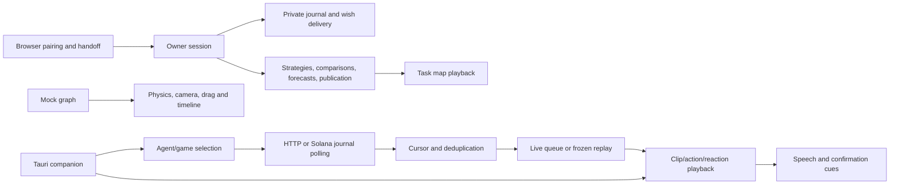

# ALASHI frontend state-machine inventory

Scope: `/Users/amir/Downloads/alashi-main/frontend/src`, the Tauri companion, and public HTML entry points. Read-only source audit. References are local source lines. The parent verified the production source against GitHub main `7113b9af330a9bce90b35919fdb37a4d3d20f230`. I inspected the two differing frontend files: `frontend/src/Onboarding.tsx` and `frontend/src/strategies/Page.tsx` contain copy/markup changes only; their state logic is unchanged. The state-logic references below precede the added markup and also retain the same line numbers on that commit.

Method: enumerated route entry points and mutable state (`useState`, refs, stores, timers, event listeners, worker messages, pending requests), then read transition writers and callers. An inventory entry is a cohesive machine family, sometimes with named instances. This is not a count of every boolean or every animated property. A boolean toggle by itself, a pure geometric interpolation, static fixtures, and a decoder without a lifecycle are not separate machines. Many state labels below are reconstructed from code, not actual enum members. Explicit unions that describe only one axis do not make the whole composite machine explicit.

There are 46 frontend/companion machine families below. Some are infrastructure or secondary/demo surfaces, not gameplay rules. Their state spaces overlap by composition; do not interpret 46 as mutually independent machines. The donkey presentation model is separately identified as an already explicit projection and is excluded from that count.

## Browser identity and private owner workflows

| ID | Machine and source | Reconstructed states | Triggers, guards and invariants |
|---|---|---|---|
| FE01 | Browser pairing and reconnect: [frontend/src/Onboarding.tsx:75](../../frontend/src/Onboarding.tsx#L75), [frontend/src/Onboarding.tsx:88](../../frontend/src/Onboarding.tsx#L88), [frontend/src/Onboarding.tsx:109](../../frontend/src/Onboarding.tsx#L109), [frontend/src/Onboarding.tsx:146](../../frontend/src/Onboarding.tsx#L146), [frontend/src/Onboarding.tsx:181](../../frontend/src/Onboarding.tsx#L181); storage/API in [frontend/src/owner/pairing.ts:50](../../frontend/src/owner/pairing.ts#L50) | idle; preparing grant; grant ready; copying; copied/manual-copy; waiting for runner; resuming after reload; paired/navigating; expired/error. Reconnect/new is a second axis. | Login/Connect allocates a grant; clipboard success or manual fallback starts polling; a sessionStorage marker restores pending pairing. Poll every 5 s, guarded by `polling`; expiry or invalid cookie asks for a new prompt. Successful pairing remembers public locator and navigates. Clipboard grants remain in memory, not locator storage. `pairing`, `copied`, `resuming`, `copying`, `pairingMode`, `hasSession` jointly define the machine. |
| FE02 | One-use owner-link redemption: [frontend/src/owner/pairing.ts:86](../../frontend/src/owner/pairing.ts#L86), [frontend/src/owner/pairing.ts:91](../../frontend/src/owner/pairing.ts#L91), [frontend/src/owner/pairing.ts:110](../../frontend/src/owner/pairing.ts#L110); consumer [frontend/src/devnet/DevnetPage.tsx:266](../../frontend/src/devnet/DevnetPage.tsx#L266) | uncaptured; captured+URL stripped; redeeming; redeemed+locator saved; invalid/expired. | `primeOwnerFragment` strips hash before routing. Module-level `redemption` promise deduplicates StrictMode requests. Component effect handles result; success/failure forgets fragment. Valid record/code/game required. The handoff suppresses remembered locator until redemption resolves. |
| FE03 | Owner authentication/session lifecycle, two implementations: [frontend/src/live/api/OwnerPanel.tsx:12](../../frontend/src/live/api/OwnerPanel.tsx#L12), [frontend/src/live/api/OwnerPanel.tsx:38](../../frontend/src/live/api/OwnerPanel.tsx#L38), [frontend/src/live/api/OwnerPanel.tsx:46](../../frontend/src/live/api/OwnerPanel.tsx#L46), [frontend/src/live/api/OwnerPanel.tsx:88](../../frontend/src/live/api/OwnerPanel.tsx#L88), [frontend/src/live/api/OwnerPanel.tsx:137](../../frontend/src/live/api/OwnerPanel.tsx#L137); [frontend/src/devnet/ChainOwnerPanel.tsx:44](../../frontend/src/devnet/ChainOwnerPanel.tsx#L44), [frontend/src/devnet/ChainOwnerPanel.tsx:52](../../frontend/src/devnet/ChainOwnerPanel.tsx#L52), [frontend/src/devnet/ChainOwnerPanel.tsx:102](../../frontend/src/devnet/ChainOwnerPanel.tsx#L102), [frontend/src/devnet/ChainOwnerPanel.tsx:152](../../frontend/src/devnet/ChainOwnerPanel.tsx#L152); wallet boundary [frontend/src/live/api/wallet.ts:32](../../frontend/src/live/api/wallet.ts#L32) | restoring; guest; connecting wallet; challenge obtained; signing; creating session; verifying cookie persisted; owner; revoking; locally hidden but revoke uncertain. | `Access` explicitly names only restoring/guest/owner. Actual states also use `session`, `busy`, `wallet`, `connectedWallet`, `logoutRetry`, abort controllers and generation. Challenge validates origin/record/wallet/expiry. Response is re-read to prove cookie persisted. Generation invalidates old async work. Expiry, wallet change and disconnect clear private state before revoke. Solana variant additionally matches faction wallet, forgets locator, and clears on pagehide. `access === owner` implies a non-null session in rendering. |
| FE04 | Private-journal synchronization, HTTP and Solana variants: [frontend/src/live/api/OwnerPanel.tsx:110](../../frontend/src/live/api/OwnerPanel.tsx#L110); [frontend/src/devnet/ChainOwnerPanel.tsx:125](../../frontend/src/devnet/ChainOwnerPanel.tsx#L125) | disabled (guest/sending/custom owner content); loading; catching up; online; reconnecting with retained journal; authentication lost. | Cursor starts at zero each effect run, rejects rollback, merges versioned wishes; 20 ms catch-up or 2 s normal poll, exponential backoff on errors. Auth failure clears private state. Solana variant pauses while hidden, validates game/faction binding and clears `bound` on network failure. `journalReady`, `journalOnline`, quota and binding determine submission eligibility. |
| FE05 | Wish submission/idempotent retry, two variants: [frontend/src/live/api/OwnerPanel.tsx:165](../../frontend/src/live/api/OwnerPanel.tsx#L165); [frontend/src/devnet/ChainOwnerPanel.tsx:182](../../frontend/src/devnet/ChainOwnerPanel.tsx#L182) | editable draft; sending a frozen UUID/body; acknowledged; delivery uncertain with immutable pending body; rejected definitively; discarded locally; invalidated by logout. | Ref guard prevents duplicate submit in one render. Before fetch: freeze body, pause journal, retain UUID. Success clears pending and refreshes quota/journal. Ambiguous failure retains exact body for retry. Known permanent errors clear it. Discard warns the request may already have arrived. Solana adds active binding, selected intent, matching session wallet and expiry checks. Journal statuses (`received`, `consumed`, etc.) are server lifecycle projections, not authored by this UI. |
| FE06 | Registered-agent watch: [frontend/src/agent.ts:24](../../frontend/src/agent.ts#L24), [frontend/src/agent.ts:30](../../frontend/src/agent.ts#L30), [frontend/src/agent.ts:37](../../frontend/src/agent.ts#L37); keyed caller [frontend/src/routes/index.tsx:43](../../frontend/src/routes/index.tsx#L43) | absent; invalid ID; loading; unreachable; unknown registration; waiting without game; playing; waiting while retaining last finished game. | TanStack query polls 5 s. `followGame` picks active slot or retains previous game. App remounts for a different agent, preventing its last-game state carrying to another agent. `AgentWatch` is an explicit discriminated result, but query+remembered game compose the transition logic. |

## Public data and presentation orchestration

| ID | Machine and source | Reconstructed states | Triggers, guards and invariants |
|---|---|---|---|
| FE07 | Legacy HTTP arena feed and reaction queue: [frontend/src/feed.ts:56](../../frontend/src/feed.ts#L56), [frontend/src/feed.ts:77](../../frontend/src/feed.ts#L77), [frontend/src/feed.ts:88](../../frontend/src/feed.ts#L88), [frontend/src/feed.ts:93](../../frontend/src/feed.ts#L93); cursor [frontend/src/events.ts:37](../../frontend/src/events.ts#L37); callers [frontend/src/App.tsx:46](../../frontend/src/App.tsx#L46), [frontend/companion/web/Companion.tsx:172](../../frontend/companion/web/Companion.tsx#L172) | source off/sample/live; uninitialized cursor; history seeded; receiving fresh events; gap; queued; act; accepted/rejected; final line queued; polling terminal. | Query stops at finished/unknown; first snapshot establishes context without replay. Fresh events append to max-6 queue; every 3.2 s emits speech+act, 1.1 s later emits result clip. Special poke clip blocks processing. Important scope gap below: queue is not cleared when game/mode changes. |
| FE08 | Personal HTTP public stream: [frontend/src/live/api/usePublicStream.ts:6](../../frontend/src/live/api/usePublicStream.ts#L6) | bootstrapping/backfilling; connected; reconnecting; cursor reset with explicit gap; resumed but suppressing backlog cues. Presence unknown/online/offline is independent. | Cursor/retained refs survive retry. New record resets both. Expired/ahead cursor resets journal; sequence rollback rejected; 20 ms pages, 1.8 s live, exponential backoff. `bootstrapped` and `skipResumeBatch` suppress first-load/hidden-backlog animation while retaining records. Used by `/stream`. |
| FE09 | Stream selection and profile context: [frontend/src/live/StreamPage.tsx:145](../../frontend/src/live/StreamPage.tsx#L145), [frontend/src/live/StreamPage.tsx:100](../../frontend/src/live/StreamPage.tsx#L100) | no record; validating ID; opening profile; connected record; profile unavailable/between games; change-agent reset. | Validate direct ID or same-origin stream link, fetch profile, then update URL and mount keyed ConnectedStream. Background profile polls every 5 s and clears slots on failure. Page is gated by `VITE_LIVE_API_ENABLED`; connection logic exists even though deployment flag was not inspected. |
| FE10 | Personal-stream visual arbitration: [frontend/src/live/StreamPage.tsx:48](../../frontend/src/live/StreamPage.tsx#L48), [frontend/src/live/StreamPage.tsx:60](../../frontend/src/live/StreamPage.tsx#L60), [frontend/src/live/StreamPage.tsx:81](../../frontend/src/live/StreamPage.tsx#L81), [frontend/src/live/StreamPage.tsx:86](../../frontend/src/live/StreamPage.tsx#L86) | idle; gesture reaction; active trade/scenario; active action with pending queue; completion; hidden backlog dropped. | Own message may speak; cue ID dedup prevents repeated gesture. Confirmed own game actions require active slot match. Action preempts reaction; at most two pending actions retained. Only child completion dequeues. Visibility clears pending queue. This differs from devnet replay and has a WebGL-failure stuck-state gap below. |
| FE11 | Solana snapshot polling: [frontend/src/devnet/useChainSnapshot.ts:4](../../frontend/src/devnet/useChainSnapshot.ts#L4) | initial waiting; in flight; ready; cooldown; backoff with last snapshot; hidden; final settled+complete. | `requestInFlight`, `retryAt`, closure `final/stopped`, error and nullable snapshot determine behavior. 12 s normal interval, retry-after-aware exponential delay. Hidden tab stops schedule; pageshow/visibility resumes. Final requires both settled and complete. Abort/stopped guards prevent unmounted response writes. Mounted via game-keyed DevnetPage and constant home replay game. |
| FE12 | Public onchain conversation-journal polling: [frontend/src/devnet/useChainConversations.ts:6](../../frontend/src/devnet/useChainConversations.ts#L6) | disabled; loading; paging; connected; backoff; hidden; terminal with no more pages. | Separate cached journal, in-flight/ref clock and terminalRef. Reject duplicate IDs or >10,000 entries. Catch-up immediately, otherwise 12 s. Terminal stop is `terminalRef.current &&!page.has_more`, independent of `history_complete`, which remains visibly separate. Retry starts a fresh effect. This finality contract deserves explicit documentation if server journal can grow after the game ends; no defect established. |
| FE13 | Runner dialogue journal: [frontend/src/devnet/dialogueClient.ts:55](../../frontend/src/devnet/dialogueClient.ts#L55) | disabled; loading; fetching pages; polling tail; reconnecting; invalid data with retained entries. | Cursor and entry map reset on game/enabled/revision. Duplicate identical messages accepted; conflicting duplicate or >10,000 rejected. 5 s tail polling; backoff on failure. Unlike FE12 it has no terminal/visibility stop. The renderer splits replay-anchored messages and unanchored history (`dialogueView:93`). |
| FE14 | Solana live-event cursor: [frontend/src/devnet/playback.ts:3](../../frontend/src/devnet/playback.ts#L3); caller [frontend/src/devnet/DevnetPage.tsx:123](../../frontend/src/devnet/DevnetPage.tsx#L123) | unready; incomplete history seen; complete baseline; tail present with fresh additions; lost tail/rebaseline. | Every event ID enters `seen`; incomplete snapshot emits no animation. First complete snapshot or lost tail resets baseline and emits none. Subsequent complete snapshots emit only fresh events after tail. Separate from the network poller and from replay; explicitly represented as cursor data but transitions are ordinary function logic. |
| FE15 | Devnet game viewer live/replay controller: [frontend/src/devnet/DevnetPage.tsx:83](../../frontend/src/devnet/DevnetPage.tsx#L83), [frontend/src/devnet/DevnetPage.tsx:112](../../frontend/src/devnet/DevnetPage.tsx#L112), [frontend/src/devnet/DevnetPage.tsx:113](../../frontend/src/devnet/DevnetPage.tsx#L113), [frontend/src/devnet/DevnetPage.tsx:144](../../frontend/src/devnet/DevnetPage.tsx#L144), [frontend/src/devnet/DevnetPage.tsx:163](../../frontend/src/devnet/DevnetPage.tsx#L163), [frontend/src/devnet/DevnetPage.tsx:164](../../frontend/src/devnet/DevnetPage.tsx#L164), [frontend/src/devnet/DevnetPage.tsx:218](../../frontend/src/devnet/DevnetPage.tsx#L218) | live idle; live action+bounded queue; replay loading current event; replay playing; replay paused; finish deferred while paused; seeking/restarting; replay finished; return to latest; one-time winner replay. | Composite of mode/current/playing/playingRef/position/take/completedTake/deferredFinish/replayRevision/replaySnapshot/replayEvents/queue. Completion is take-idempotent; paused completion defers advancement. Frozen journal/snapshot prevent a poll replacing replay. Nonanimated events advance after 1.8 s; visual actions have a 10 s watchdog. Reset/selection invalidates current take and live queue. Hidden/offscreen live backlog suppressed. Default winner replay starts only once from unique rank-zero payout in complete settled history. This is one of the highest-value explicit-machine candidates. |
| FE16 | Home replay controller: [frontend/src/devnet/HomeChainPreview.tsx:22](../../frontend/src/devnet/HomeChainPreview.tsx#L22), [frontend/src/devnet/HomeChainPreview.tsx:33](../../frontend/src/devnet/HomeChainPreview.tsx#L33), [frontend/src/devnet/HomeChainPreview.tsx:38](../../frontend/src/devnet/HomeChainPreview.tsx#L38), [frontend/src/devnet/HomeChainPreview.tsx:45](../../frontend/src/devnet/HomeChainPreview.tsx#L45), [frontend/src/devnet/HomeChainPreview.tsx:61](../../frontend/src/devnet/HomeChainPreview.tsx#L61), [frontend/src/devnet/HomeChainPreview.tsx:88](../../frontend/src/devnet/HomeChainPreview.tsx#L88) | waiting for complete settled history; playing event; resting between events; paused; unavailable/offscreen suspended; resume with precise seek; completed. | Snapshot history frozen at mount. `clock={index,take,playing,resting,seek}` is nearly a reducer but effects do transitions. Guards reject repeated/stale completions. Rest 350 ms, nonvisual 1.8 s, watchdog 10 s. Resume increments take and seeks to last reported time. Faction key remounts replay on player change. |
| FE17 | Public-journal historical browsing: [frontend/src/devnet/ChainConversationStream.tsx:115](../../frontend/src/devnet/ChainConversationStream.tsx#L115), [frontend/src/devnet/ChainConversationStream.tsx:146](../../frontend/src/devnet/ChainConversationStream.tsx#L146), [frontend/src/devnet/ChainConversationStream.tsx:165](../../frontend/src/devnet/ChainConversationStream.tsx#L165), [frontend/src/devnet/ChainConversationStream.tsx:171](../../frontend/src/devnet/ChainConversationStream.tsx#L171), [frontend/src/devnet/ChainConversationStream.tsx:218](../../frontend/src/devnet/ChainConversationStream.tsx#L218) | compact preview; expanded following latest; expanded reading anchored history; loading earlier; changing scope; dismissed. | `following`, `historyStart`, visibleCount and saved scroll anchor keep history stable while live entries arrive. Loading earlier adds 20 and preserves scroll offset. Latest restores tail; outside pointer closes drawer/info. Player/all filters derive from validated journal, and missing response is not inferred as decline. |
| FE18 | HTTP arena viewer's independently polled sources: [frontend/src/arena/ArenaPage.tsx:22](../../frontend/src/arena/ArenaPage.tsx#L22), [frontend/src/arena/ArenaPage.tsx:39](../../frontend/src/arena/ArenaPage.tsx#L39), [frontend/src/arena/ArenaPage.tsx:51](../../frontend/src/arena/ArenaPage.tsx#L51), [frontend/src/arena/ArenaPage.tsx:68](../../frontend/src/arena/ArenaPage.tsx#L68) | catalog loading/ready/error; selected snapshot loading/live/final/error; event cursor loading/ready/gapped/final/error. | Three concurrent machines: 1.5 s snapshot, 3 s catalog, 2 s journal. Selecting game resets snapshot/events/cursor/observed timing. Final is latched by snapshot.finished or final_result event. Cursor expiry resets cursor and marks truncation. Network errors preserve prior records. Polling continues after final. |
| FE19 | Administrator log access gate: [frontend/src/log/AdminLogGate.tsx:9](../../frontend/src/log/AdminLogGate.tsx#L9) | checking; unavailable; denied; authorized/loading component; rendered log. | Query validates explicit admin role; 401/403 means denied, transport/invalid type means unavailable. Retry is explicit. Owner session never grants admin access. Suspense adds component-loading state. |
| FE20 | Admin log accumulation and replay: [frontend/src/log/LogPage.tsx:31](../../frontend/src/log/LogPage.tsx#L31), [frontend/src/log/LogPage.tsx:47](../../frontend/src/log/LogPage.tsx#L47), [frontend/src/log/LogPage.tsx:56](../../frontend/src/log/LogPage.tsx#L56) | loading live log; accumulating unique received rows; final snapshot; replaying prefix; replay complete/stopped; terminal query error. | Live rows merge by key; final history replaces accumulation for display. `shown=null` means full history, numeric means replay prefix; 450 ms ticks advance. Query stops on error/final/unknown. Parent keys LogPage by game, preventing cross-game accumulator leakage. |

## Strategies and research controls

These are UI machines over server-authoritative lifecycles. The server/runner audit should own the canonical run, budget, call, forecast and publication lifecycles; the rows here identify separate browser state and guards, not duplicate ownership.

| ID | Machine and source | Reconstructed states | Triggers, guards and invariants |
|---|---|---|---|
| FE21 | Research/strategy read synchronization: [frontend/src/strategies/Page.tsx:44](../../frontend/src/strategies/Page.tsx#L44), [frontend/src/strategies/Page.tsx:88](../../frontend/src/strategies/Page.tsx#L88), [frontend/src/strategies/Page.tsx:94](../../frontend/src/strategies/Page.tsx#L94); [frontend/src/strategies/ResearchPanel.tsx:19](../../frontend/src/strategies/ResearchPanel.tsx#L19), [frontend/src/strategies/ResearchPanel.tsx:55](../../frontend/src/strategies/ResearchPanel.tsx#L55); [frontend/src/strategies/ComparisonPanel.tsx:35](../../frontend/src/strategies/ComparisonPanel.tsx#L35); [frontend/src/strategies/TradingRuns.tsx:4](../../frontend/src/strategies/TradingRuns.tsx#L4) | loading; fresh data; reconnecting with retained data (public library/trading); error with data cleared (private strategy library); session invalidated. | Each poller owns its controller+timer and different retention policy. Private comparison/research responses are ignored while mutation ref guard is held, avoiding stale polls overwriting mutation response. Private library polls 1.5 s, public 1 s, research 5 s, trading 2 s. Mechanism library is one-shot/revision driven. |
| FE22 | Immutable strategy editor and publication: [frontend/src/strategies/Page.tsx:35](../../frontend/src/strategies/Page.tsx#L35), [frontend/src/strategies/Page.tsx:55](../../frontend/src/strategies/Page.tsx#L55), [frontend/src/strategies/Page.tsx:59](../../frontend/src/strategies/Page.tsx#L59), [frontend/src/strategies/Page.tsx:69](../../frontend/src/strategies/Page.tsx#L69), [frontend/src/strategies/Page.tsx:77](../../frontend/src/strategies/Page.tsx#L77) | original/derivative editing; saving; saved version selected; publishing private saved version; error. | Form JSON parsed on submit; `perform` ref guard serializes local mutations; active ref suppresses post-unmount UI writes. Parent version retained; private derivative must explicitly publish before duel admission. Server version returned is added to local library; public variant also updates public list. |
| FE23 | Duel admission and hosting request recovery: [frontend/src/strategies/Page.tsx:42](../../frontend/src/strategies/Page.tsx#L42), [frontend/src/strategies/Page.tsx:75](../../frontend/src/strategies/Page.tsx#L75), [frontend/src/strategies/Page.tsx:80](../../frontend/src/strategies/Page.tsx#L80) | selected strategy+challenge; submitting frozen entry; uncertain entry/pending retry; accepted runner selected; hosting draft; frozen match-key request; hosting success. | Entry body includes stable client UUID retained until success/discard. Host uses ref-held request with stable match_key until success; editing brief clears it. Both share `perform` serialization. UI's `runner` is only a selected receipt, not a browser execution process. |
| FE24 | Private comparison preparation and owner decision: [frontend/src/strategies/ComparisonPanel.tsx:19](../../frontend/src/strategies/ComparisonPanel.tsx#L19), [frontend/src/strategies/ComparisonPanel.tsx:27](../../frontend/src/strategies/ComparisonPanel.tsx#L27), [frontend/src/strategies/ComparisonPanel.tsx:46](../../frontend/src/strategies/ComparisonPanel.tsx#L46), [frontend/src/strategies/ComparisonPanel.tsx:54](../../frontend/src/strategies/ComparisonPanel.tsx#L54), [frontend/src/strategies/ComparisonPanel.tsx:72](../../frontend/src/strategies/ComparisonPanel.tsx#L72), [frontend/src/strategies/ComparisonPanel.tsx:77](../../frontend/src/strategies/ComparisonPanel.tsx#L77) | drafting eligible one-instruction diff; freezing comparison; frozen; forecast collection open; preparing paired attempt; ambiguous attempt retry; runs active; decision eligible; decided. | Explicit decision options are derived from both run terminal states, usage certainty and reserved calls. Paired attempt carries stable UUID in `pendingAttempt`. Forecast-open blocks preparation. Selected attempt change resets outcome/reason/notice; only allowed outcomes can submit. Browser does not call provider. |
| FE25 | Forecast collection UI: [frontend/src/strategies/ResearchPanel.tsx:28](../../frontend/src/strategies/ResearchPanel.tsx#L28), [frontend/src/strategies/ResearchPanel.tsx:97](../../frontend/src/strategies/ResearchPanel.tsx#L97) | no round; open+unsubmitted; own forecast fixed/sealed; owner can close; closed/revealed; comparison already started prevents new forecast. | Participant membership gates submission. Forecast immutable after recorded. Owner close requires at least one submitted forecast; missing participants remain missing. Open round permits attempt only after closure in FE24. States derive from nullable own_forecast/closed_at and membership rather than a local enum. |
| FE26 | Backlog create/edit/move and public-card reuse: [frontend/src/strategies/ResearchPanel.tsx:44](../../frontend/src/strategies/ResearchPanel.tsx#L44), [frontend/src/strategies/ResearchPanel.tsx:66](../../frontend/src/strategies/ResearchPanel.tsx#L66), [frontend/src/strategies/ResearchPanel.tsx:74](../../frontend/src/strategies/ResearchPanel.tsx#L74), [frontend/src/strategies/ResearchPanel.tsx:76](../../frontend/src/strategies/ResearchPanel.tsx#L76), [frontend/src/strategies/ResearchPanel.tsx:94](../../frontend/src/strategies/ResearchPanel.tsx#L94), [frontend/src/strategies/ResearchPanel.tsx:95](../../frontend/src/strategies/ResearchPanel.tsx#L95) | new idea; editing existing idea; saving; saved; now/later; linked comparison; pending card reuse; reused/cancelled. | Stable ideaClient and reuseClient IDs survive ambiguous retries. `act` serializes mutations and updates workspace. Success resets editor or clears requested card; reuse never starts a run. |
| FE27 | Applying a decided strategy: [frontend/src/strategies/ResearchPanel.tsx:104](../../frontend/src/strategies/ResearchPanel.tsx#L104); consumers [frontend/src/strategies/Page.tsx:40](../../frontend/src/strategies/Page.tsx#L40), [frontend/src/strategies/ComparisonPanel.tsx:31](../../frontend/src/strategies/ComparisonPanel.tsx#L31) | no default; eligible decided attempt; applying; applied default; different later attempt available. | Only non-inconclusive decision permits Apply; same applied attempt disables it. Server returns applied version; effects select that default for future entries/baselines. Existing run snapshots unchanged. |
| FE28 | Daily digest acknowledgement: [frontend/src/strategies/ResearchPanel.tsx:89](../../frontend/src/strategies/ResearchPanel.tsx#L89), [frontend/src/strategies/ResearchPanel.tsx:92](../../frontend/src/strategies/ResearchPanel.tsx#L92) | unread fingerprint/day; acknowledging; read; fresh server digest becomes unread again. | Ack body freezes day+fingerprint; `act` replaces workspace with authoritative result. Distinct from merely opening a UI panel. |
| FE29 | Public mechanism-card preparation/import/consent/publication: [frontend/src/strategies/ResearchPanel.tsx:46](../../frontend/src/strategies/ResearchPanel.tsx#L46), [frontend/src/strategies/ResearchPanel.tsx:51](../../frontend/src/strategies/ResearchPanel.tsx#L51), [frontend/src/strategies/ResearchPanel.tsx:64](../../frontend/src/strategies/ResearchPanel.tsx#L64), [frontend/src/strategies/ResearchPanel.tsx:77](../../frontend/src/strategies/ResearchPanel.tsx#L77), [frontend/src/strategies/ResearchPanel.tsx:107](../../frontend/src/strategies/ResearchPanel.tsx#L107), [frontend/src/strategies/ResearchPanel.tsx:110](../../frontend/src/strategies/ResearchPanel.tsx#L110) | source selected; import in flight; valid public local card; failed import; text under review; consent for exact context; publishing; published with consent cleared. | Generation invalidates stale async file reads. Only <=30 KB parsed public card accepted. Consent binds serialized source+attempt+local client ID+all card fields; changing any invalidates it. No publish while importing, without source or decision, or without exact consent. Server publication requires own guarded mutation. This is a high-value explicit-machine candidate due to privacy boundary. |
| FE30 | Task-map playback and asset lifecycle: [frontend/src/strategies/Map.tsx:17](../../frontend/src/strategies/Map.tsx#L17), [frontend/src/strategies/Map.tsx:27](../../frontend/src/strategies/Map.tsx#L27), [frontend/src/strategies/Map.tsx:31](../../frontend/src/strategies/Map.tsx#L31), [frontend/src/strategies/Map.tsx:87](../../frontend/src/strategies/Map.tsx#L87), [frontend/src/strategies/Map.tsx:90](../../frontend/src/strategies/Map.tsx#L90); staged task transformation [frontend/src/strategies/timeline.ts:3](../../frontend/src/strategies/timeline.ts#L3), [frontend/src/strategies/atlasMotion.ts:8](../../frontend/src/strategies/atlasMotion.ts#L8) | loading assets; unavailable; running timeline; network frozen; user paused; seeking; completed/paused; restarted; disposed. | Canvas clock advances only online+unpaused and clamps slow frames. Ongoing tasks have no fixed duration. Finished timeline with player controls auto-pauses; play after end restarts. Team IDs/replay revision rebuild asset/render effect. Worker motion derives leaving/working/returning/idle from timestamps; not a second mutable game state. |

## Rendering, demos and secondary visual surfaces

| ID | Machine and source | Reconstructed states | Triggers, guards and invariants |
|---|---|---|---|
| FE31 | Scene render scheduling/adaptive quality: [frontend/src/genie/Scene.tsx:71](../../frontend/src/genie/Scene.tsx#L71), [frontend/src/genie/Scene.tsx:95](../../frontend/src/genie/Scene.tsx#L95) | in viewport requesting frames; offscreen suspended; disposed; DPR levels from 1 to device cap; fallback DPR 1. | IntersectionObserver gates invalidation; rAF driver caps at 60 FPS. PerformanceMonitor adjusts DPR by.5 and fallback. Resource effect `StudioEnvironment:38` allocates/disposes owned environment. Browser frame suspension is part of presentation timing, not game time. |
| FE32 | Legacy genie clip and poke arbitration: [frontend/src/store.ts:17](../../frontend/src/store.ts#L17); [frontend/src/genie/GenieModel.tsx:18](../../frontend/src/genie/GenieModel.tsx#L18), [frontend/src/genie/GenieModel.tsx:65](../../frontend/src/genie/GenieModel.tsx#L65), [frontend/src/genie/GenieModel.tsx:95](../../frontend/src/genie/GenieModel.tsx#L95), [frontend/src/genie/GenieModel.tsx:104](../../frontend/src/genie/GenieModel.tsx#L104) | idle loop; one-shot clip; crossfade; retrigger; frozen pose; reduced-motion held pose with deadline; triple-tap poke; back to idle. | `clip` union alone is explicit; `take`, current AnimationAction, frozen/reducedMotion and completion event compose lifecycle. Same clip retrigger increments take. Finished current one-shot returns idle; reduced-motion timer emulates it. Three taps inside 900 ms trigger guarded poke. Shared by home/HTTP and companion. |
| FE33 | Custom action/reaction playback family, three instances: [frontend/src/live/market/MarketTrade.tsx:84](../../frontend/src/live/market/MarketTrade.tsx#L84), [frontend/src/live/market/MarketTrade.tsx:95](../../frontend/src/live/market/MarketTrade.tsx#L95), [frontend/src/live/market/MarketTrade.tsx:98](../../frontend/src/live/market/MarketTrade.tsx#L98), [frontend/src/live/market/MarketTrade.tsx:228](../../frontend/src/live/market/MarketTrade.tsx#L228); [frontend/src/live/actions/ScenarioAction.tsx:42](../../frontend/src/live/actions/ScenarioAction.tsx#L42), [frontend/src/live/actions/ScenarioAction.tsx:55](../../frontend/src/live/actions/ScenarioAction.tsx#L55), [frontend/src/live/actions/ScenarioAction.tsx:64](../../frontend/src/live/actions/ScenarioAction.tsx#L64); [frontend/src/live/reactions/LivingGenie.tsx:50](../../frontend/src/live/reactions/LivingGenie.tsx#L50), [frontend/src/live/reactions/LivingGenie.tsx:70](../../frontend/src/live/reactions/LivingGenie.tsx#L70) | reset/new take; exact first frame; playing; paused; sought frame; reduced-motion presentation; complete-callback latched; idle (LivingGenie). | Time+finished+firstFrame/restarted flags ensure one finish per take and exact seeks. Separate durations for trade, scenario and reaction. onTime throttled; completion signals parent. Timed stage data is already explicit for mule/bribe/vote (`actions/definitions.ts:19`), while transitions are elapsed-time thresholds. These machines do not validate economic success; parents supply provenance. |
| FE34 | Speech typewriter/pagination: [frontend/src/genie/ScreenText.tsx:12](../../frontend/src/genie/ScreenText.tsx#L12); [frontend/src/genie/screenTimeline.ts:20](../../frontend/src/genie/screenTimeline.ts#L20); store [frontend/src/store.ts:24](../../frontend/src/store.ts#L24) | no speech; typing page; page hold; next page; cleared; final page held for poke; externally clocked/paused; reduced-motion full page. | speechId resets autonomous clock even for same text. Parent animation clock overrides autonomous time; each page types at 32 chars/s then holds 1.8 s. Explicit pure `speechFrame` computes temporal state; mutable epoch is in component/ref. |
| FE35 | Receipt cue and studio pulse: [frontend/src/live/market/MarketTrade.tsx:39](../../frontend/src/live/market/MarketTrade.tsx#L39), [frontend/src/live/market/MarketTrade.tsx:198](../../frontend/src/live/market/MarketTrade.tsx#L198); [frontend/src/studio/StudioStage.tsx:9](../../frontend/src/studio/StudioStage.tsx#L9) | token captured/unavailable; waiting for contact; cue attempted; pulse active; invalidated/cancelled; duplicate suppressed. | Per-take receipt flags pair with stage epoch and global seen receipt IDs. Contact at 3.65 s can confirm only once, only visible, within cue window, not reduced motion. Scroll/visibility/resize/motion change increments epoch and cancels pulse. Seen ID is recorded even when visibility blocks it, preventing delayed success cue. |
| FE36 | Recoverable-route versus sticky-3D failure lifecycle: [frontend/src/App.tsx:18](../../frontend/src/App.tsx#L18), [frontend/src/live/StreamPage.tsx:31](../../frontend/src/live/StreamPage.tsx#L31), [frontend/src/live/LivePage.tsx:21](../../frontend/src/live/LivePage.tsx#L21), [frontend/src/devnet/HomeChainPreview.tsx:16](../../frontend/src/devnet/HomeChainPreview.tsx#L16), [frontend/src/devnet/DevnetPage.tsx:42](../../frontend/src/devnet/DevnetPage.tsx#L42); [frontend/src/routes/__root.tsx:5](../../frontend/src/routes/__root.tsx#L5) | lazy loading; rendered; failed fallback. | React boundaries latch `failed=true` with no internal retry; remount resets them. Root route uses router reset callback. The parent queue must tolerate missing child completion after a sticky 3D failure; FE15/FE16 do, FE10 does not. |
| FE37 | Offline `/live` demonstration timeline and manual-preview arbitration: [frontend/src/live/LivePage.tsx:29](../../frontend/src/live/LivePage.tsx#L29), [frontend/src/live/LivePage.tsx:75](../../frontend/src/live/LivePage.tsx#L75), [frontend/src/live/LivePage.tsx:87](../../frontend/src/live/LivePage.tsx#L87), [frontend/src/live/LivePage.tsx:108](../../frontend/src/live/LivePage.tsx#L108), [frontend/src/live/LivePage.tsx:125](../../frontend/src/live/LivePage.tsx#L125), [frontend/src/live/LivePage.tsx:134](../../frontend/src/live/LivePage.tsx#L134) | running demo; paused; ended at 45 s; scenario reset; manual trade preview; manual reaction preview; preview complete. | 250 ms wall clock advances with chosen speed; scenario/session ID controls speech dedup. Manual preview pauses demo and clears the other preview. Demo events may set clip/trade; they are labelled fixtures and perform no API/game mutation. |
| FE38 | Mock graph timelapse/range selection: [frontend/src/graph/view.ts:66](../../frontend/src/graph/view.ts#L66), [frontend/src/graph/view.ts:98](../../frontend/src/graph/view.ts#L98); [frontend/src/graph/timeline.tsx:8](../../frontend/src/graph/timeline.tsx#L8), [frontend/src/graph/timeline.tsx:18](../../frontend/src/graph/timeline.tsx#L18), [frontend/src/graph/timeline.tsx:40](../../frontend/src/graph/timeline.tsx#L40) | all rounds; playing round prefix; paused at round; ended; drag-selecting range; fixed range. | setPlay clears range; setRange stops play+clears play; reset clears both. 700 ms timer advances until final round. Pointerup ends histogram drag. Graph data is explicitly mock ([frontend/src/graph/GraphPage.tsx:20](../../frontend/src/graph/GraphPage.tsx#L20)). |
| FE39 | Mock graph overview/local/layout orchestration: [frontend/src/graph/GraphPage.tsx:38](../../frontend/src/graph/GraphPage.tsx#L38), [frontend/src/graph/GraphPage.tsx:65](../../frontend/src/graph/GraphPage.tsx#L65); [frontend/src/graph/agent-graph.ts:415](../../frontend/src/graph/agent-graph.ts#L415), [frontend/src/graph/agent-graph.ts:446](../../frontend/src/graph/agent-graph.ts#L446), [frontend/src/graph/agent-graph.ts:487](../../frontend/src/graph/agent-graph.ts#L487), [frontend/src/graph/agent-graph.ts:1171](../../frontend/src/graph/agent-graph.ts#L1171) | first layout; overview force simulation; background overview precompute while local; local force; local layers; morph between layouts; settled; destroyed. | Focus change selects local mode. Layout/view signatures determine whether to recompute. Switching mode saves overview positions/unfinished alpha; return restores or warms simulation. Morph stops foreground simulation and completes into next simulation when needed. Refs/booleans/timer nullability coordinate this, without a transition table. |
| FE40 | Graph physics worker protocol, foreground/background instances: [frontend/src/graph/layout.ts:23](../../frontend/src/graph/layout.ts#L23); [frontend/src/graph/layout.worker.ts:35](../../frontend/src/graph/layout.worker.ts#L35), [frontend/src/graph/layout.worker.ts:53](../../frontend/src/graph/layout.worker.ts#L53), [frontend/src/graph/layout.worker.ts:58](../../frontend/src/graph/layout.worker.ts#L58), [frontend/src/graph/layout.worker.ts:79](../../frontend/src/graph/layout.worker.ts#L79), [frontend/src/graph/layout.worker.ts:117](../../frontend/src/graph/layout.worker.ts#L117) | never started; warm-up; ticking; cooling; settled; dragged/reheated; stopped; superseded generation; terminated. | start increments generation; main thread ignores stale worker outputs. Worker tick ends below ALPHA_MIN; alphaTarget>0 restarts. stop clears timer and generation protects stale results. fix/free changes node pinning. Explicit message union, implicit lifecycle. |
| FE41 | Graph camera/fit lifecycle: [frontend/src/graph/agent-graph.ts:190](../../frontend/src/graph/agent-graph.ts#L190), [frontend/src/graph/agent-graph.ts:206](../../frontend/src/graph/agent-graph.ts#L206), [frontend/src/graph/agent-graph.ts:1097](../../frontend/src/graph/agent-graph.ts#L1097), [frontend/src/graph/agent-graph.ts:1111](../../frontend/src/graph/agent-graph.ts#L1111), [frontend/src/graph/agent-graph.ts:1138](../../frontend/src/graph/agent-graph.ts#L1138), [frontend/src/graph/agent-graph.ts:1171](../../frontend/src/graph/agent-graph.ts#L1171), [frontend/src/graph/agent-graph.ts:1208](../../frontend/src/graph/agent-graph.ts#L1208) | free camera; animating fit/fly-to; pending fit after simulation; remembered camera per mode; user-controlled override; resized. | New cam move cancels prior timer and pending fit. User zoom/drag cancels pending fit; simulation end fits only if still pending. Mode change saves/restores compatible camera; flyTo may trigger pulse. Resize shifts center without refit. |
| FE42 | Graph node interaction and visibility fades: [frontend/src/graph/agent-graph.ts:560](../../frontend/src/graph/agent-graph.ts#L560), [frontend/src/graph/agent-graph.ts:570](../../frontend/src/graph/agent-graph.ts#L570), [frontend/src/graph/agent-graph.ts:875](../../frontend/src/graph/agent-graph.ts#L875), [frontend/src/graph/agent-graph.ts:896](../../frontend/src/graph/agent-graph.ts#L896), [frontend/src/graph/agent-graph.ts:1038](../../frontend/src/graph/agent-graph.ts#L1038) | no hover/hover; node pin-drag/free; selected focus pinned; entering/visible/leaving/removed; highlighting transition. | Hover drives tooltip/opacity/link flow. Drag pins node and reheats physics; end unpins unless focused node in local force mode. Fade goals replace prior fade, settle removes invisible/leaving items. These are presentation submachines, grouped because their values feed the same graph renderer. |

## Tauri companion prototype

| ID | Machine and source | Reconstructed states | Triggers, guards and invariants |
|---|---|---|---|
| FE43 | Companion log-panel/window size and watched-game lifecycle: [frontend/companion/web/Companion.tsx:99](../../frontend/companion/web/Companion.tsx#L99), [frontend/companion/web/Companion.tsx:163](../../frontend/companion/web/Companion.tsx#L163), [frontend/companion/web/Companion.tsx:178](../../frontend/companion/web/Companion.tsx#L178) | compact genie; expanded log; resize/position adjustment pending; last selected game retained while log closed. | Route controls open flag; async fit computes monitor bounds, resizes, then repositions. Search game selection updates retained game which feeds FE07. No stale-generation guard around async fit; rapid open/close is a race candidate, not reproduced. |
| FE44 | Cross-process cursor passthrough: [frontend/companion/web/Companion.tsx:120](../../frontend/companion/web/Companion.tsx#L120); [frontend/companion/src-tauri/src/main.rs:20](../../frontend/companion/src-tauri/src/main.rs#L20), [frontend/companion/src-tauri/src/main.rs:43](../../frontend/companion/src-tauri/src/main.rs#L43) | rect set unknown/changed; cursor outside -> passthrough; cursor over hit region -> interactive. | Browser reports changed rects every 250 ms; Rust polls cursor every 40 ms and changes native ignore state only on transition. Mutex shares latest rects. Native errors are ignored but remembered state still advances, so failed native toggle can leave logical/native state divergent; prototype risk, not reproduced. |
| FE45 | Companion autonomous speech, voice and bubble lifetime: [frontend/companion/web/Companion.tsx:139](../../frontend/companion/web/Companion.tsx#L139), [frontend/companion/web/Companion.tsx:151](../../frontend/companion/web/Companion.tsx#L151), [frontend/companion/web/Companion.tsx:168](../../frontend/companion/web/Companion.tsx#L168), [frontend/companion/web/Companion.tsx:182](../../frontend/companion/web/Companion.tsx#L182) | quiet countdown; joke spoken; game speech replaces countdown; bubble visible; bubble expired; voice disabled/enabled; queued utterance/replacement. | speechId restarts idle joke timer (20/45 s) and 7 s bubble expiry. New spoken line cancels previous utterance before speaking. Turning voice off does not cancel an already speaking utterance because the effect returns before `speechSynthesis.cancel()`; source-visible behavior. |
| FE46 | Companion click versus native window drag: [frontend/companion/web/Companion.tsx:189](../../frontend/companion/web/Companion.tsx#L189) | idle; pointer down; movement below threshold; native drag dispatched; click-joke completed. | `down` ref retains screen coordinates; >4 px sends startDragging and clears down so pointerup cannot tell joke. Pointerup without drag emits joke+accepted clip. No pointercancel handler observed; residual-down behavior is a candidate to test. |

## Already explicit or derived models not counted as hidden mutable machines

- [frontend/src/devnet/donkey/model.ts:35](../../frontend/src/devnet/donkey/model.ts#L35) declares `legacy/unavailable/eligible/ineligible/pending/success/empty/abort` and `projectDonkeyRisk:83` validates event order/provenance before producing one. This is an explicit state projection of the server/onchain donkey lifecycle, not its owner. `attempt/resolution` nullable pair still embodies the substate event sequence, but it is centrally validated here.
- `AgentWatch` and `StreamState` explicitly name parts of their states; the inventory includes the remaining implicit composition and transitions rather than claiming no state modelling exists.
- Backend run/call/forecast/wish enum/string status values are decoded/rendered in `frontend/src/strategies/client.ts`, `frontend/src/strategies/research-client.ts`, `frontend/src/devnet/ownerClient.ts`, and `frontend/src/live/api/client.ts`. Their authoritative state machines belong to the backend inventory.
- `frontend/src/live/actions/definitions.ts` explicitly lists timed action stages. `frontend/src/genie/pose.ts`, rigs, hands, smoke, fireworks, atlas motion and purchase/sale functions mostly map a supplied time to geometry. They are covered by animation playback/timeline families, not counted per bone, particle or threshold.

## Concrete transition gaps

### 1. HTTP stream action can become permanently occupied after a 3D failure

Source-traced control-flow gap, no browser reproduction run. `/stream` is feature-gated.

1. `frontend/src/live/StreamPage.tsx:75-77` sets `tradeRef.current` and `trade` for an accepted action.
2. Only `finish` at `frontend/src/live/StreamPage.tsx:81-84` dequeues/clears that action.
3. [frontend/src/live/StreamPage.tsx:122](../../frontend/src/live/StreamPage.tsx#L122) wires finish only to MarketTrade/ScenarioAction callbacks inside `StreamHeroBoundary`.
4. Boundary `frontend/src/live/StreamPage.tsx:31-34` latches a fallback after renderer/model failure. No child remains to call finish.
5. Subsequent actions at [frontend/src/live/StreamPage.tsx:76](../../frontend/src/live/StreamPage.tsx#L76) append to the capped queue; gesture cues at [frontend/src/live/StreamPage.tsx:66](../../frontend/src/live/StreamPage.tsx#L66) remain suppressed because tradeRef stays non-null.

The public text feed continues, but the visual scheduler cannot recover during that mount. DevnetPage already has an analogous 10 s watchdog at `frontend/src/devnet/DevnetPage.tsx:156-161` and HomeChainPreview at `frontend/src/devnet/HomeChainPreview.tsx:38-44`; the HTTP stream lacks it. Acceptance probe: load stream, deliver action, make 3D child fail, deliver next action; scheduler should become idle/advance while retaining transcript.

### 2. Legacy HTTP feed queue survives game/source changes

Source-traced control-flow gap, no browser reproduction run.

`frontend/src/feed.ts:77-110` creates queue/ref+timer for hook lifetime. `frontend/src/events.ts:41-42` rebaselines only the cursor on a new game. Nothing clears the old queue or the 1.1 s pending result callback when game or mode changes. [frontend/src/App.tsx:49](../../frontend/src/App.tsx#L49) can change explicit `?game` while the route key is only agent (`frontend/src/routes/index.tsx:43-46`), and Companion changes its selected game on the same mount (`frontend/companion/web/Companion.tsx:178-180`). Queued speech from A can therefore play in B or off mode. This applies to legacy HTTP viewing, not the default confirmed home replay. Acceptance probe: enqueue A events, switch to B before queue drains, observe that no A caption/reaction fires afterward.

### 3. Lower-confidence contracts worth naming explicitly

- Journal finality: FE12 stops when game terminal and `has_more=false`, even when `history_complete=false`. If late runner negotiation records can arrive after this, they require explicit retry/reload. Confirm the server completeness contract before calling this a bug.
- Async native window fitting: FE43 has no sequence/abort protection around monitor lookup then resize. A slow old open operation can complete after a newer close. Prototype only, not reproduced.
- Native passthrough: FE44 records its desired `ignoring` value even if `set_ignore_cursor_events` fails, suppressing retry until pointer state changes. Static divergence path; environmental failure not reproduced.

## Verification and exclusions

No runtime source changed. No live game, wallet action, provider call, network mutation, visual acceptance or full build was run by this agent. This is a source audit, not a claim that all timing interleavings were exercised. Read route/component callers to verify remount boundaries and distinguish live/devnet, feature-gated HTTP stream, demo `/live`, mock graph and companion prototype. Public `about/index.html` and `devnet-runner.html` contain no executable scripts. Test/QA scripts, generated route table, vendor/node_modules, assets and experiment directories outside frontend were excluded from this frontend inventory.

Highest-value candidates for making transitions explicit are FE03-FE05 (owner auth/private delivery), FE15 (devnet playback), FE01 (browser pairing), FE24/FE29 (comparison/publication), then FE10 (HTTP stream visual scheduler). Existing generation IDs, stable request UUIDs, take IDs and exact consent contexts are meaningful safeguards to preserve. A transition reducer or discriminated union can be sufficient; a new state-machine dependency is not implied.
