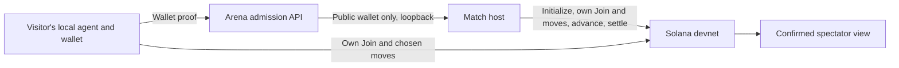

# Managed devnet opponent

source_defined, 11 October 2026. This change supplies an opponent to a solo visitor using the existing Solana program. Activation is separate from code acceptance. Production activation and a public-browser match are not_validated.



The new route is `POST /agents/{record}/chain/match`, with an owner bearer, the allowed Origin, and `{}`. A browser cookie cannot allocate a match. The arena validates the registered wallet and forwards only its public address to `127.0.0.1:8098`. The host is a separate process with its own devnet signer. Neither endpoint accepts a visitor key.

## Match behaviour

- Entry: 50,000,000 devnet lamports per faction; epoch 90s; slot-hash entropy; 20-second phases and 100-second Lobby.
- One joined faction: Alashi Bot joins in the final 20 seconds of Lobby, paying its own entry. Its public faction name identifies it as a bot. If another player joins concurrently, both and the bot may play.
- Two or more factions: no bot is added. Empty Lobbies abort and use SettleRefund. Finished games use Settle after all six rounds.
- The bot sells goods, produces, and votes Yes for the production subsidy or boom, No for other laws. The visitor's agent chooses its own moves. No LLM/provider account is needed for the platform opponent.
- The same wallet keeps its active assignment across retries. A confirmed settlement releases it for another requested match. The host saves the Game ID before initialization, reloads its book after restart, and checks faction stamps before every bot move.
- Limits: four unfinished Games and 24 new Games per rolling day. Up to six visitors share an open Lobby. One worker per Game prevents a slow RPC in one match from blocking another.

The state book is authoritative for which Games to resume. Back it up and keep its path and signer stable. Deleting it or changing the signer can strand active Games. The exclusive state lock prevents two processes from using the same book. Do not run the same signer with independent books.

`host_funds_low` means the host needs more test SOL. `match_capacity` means its limits are reached. RPC or confirmation failures retain the assignment for a retry and produce a static availability error. The host does not mint funds or request airdrops. Monitor confirmed receipts and the operator balance. Maintain enough test SOL for every admitted bot plus account rent and transaction fees. Rent for completed Game and Faction accounts is retained; automatic account closure is outside this change.

## Activation without server wallet custody

The shared-server rules forbid storing even devnet wallet keys there. Run the signer on the operator's trusted computer and forward the arena's loopback port over an approved SSH connection. The operator must keep that computer and connection awake for the match. This is suitable for supervised judging; unattended availability requires an approved persistent signer host.

Create a private state directory and supply an existing dedicated devnet key with mode `0600`. Build the reviewed bots client first. Keep the key outside Git, fund it with test SOL, then run locally:

```sh
umask 077
export ALASHI_RPC=https://api.devnet.solana.com
export ALASHI_MATCH_PORT=8098
cargo run --locked --manifest-path bots/Cargo.toml -- match-host \
  --key "<private-devnet-operator-key>" --state "<private-directory>/matches.json"
```

After the server administrator approves the port, open a reverse tunnel from that computer in another terminal:

```sh
ssh -o ExitOnForwardFailure=yes -o ServerAliveInterval=15 -o ServerAliveCountMax=3 \
  -N -R 127.0.0.1:8098:127.0.0.1:8098 <arena-host>
```

Keep the host listener and remote forwarding on loopback. Never expose `/match` publicly: authentication belongs to the arena route. The host checks the devnet genesis before accepting requests. `ALASHI_MATCH_PORT` must match on both sides if changed.

The administrator deploys the reviewed arena build and frontend guide together, preserving the existing arena state. The public proxy must forward `/agents/{record}/chain/match` to the arena. No Solana program upgrade or game-rule change is required. After activation, use a registered external visitor to verify the copied prompt, browser pairing, automatic bot entry, all rounds, and the settled public result.

For rollback, restore the prior frontend entry instructions to stop new requests, then let admitted games finish before stopping the host. Preserve its book and signer. If interrupted, restart with those same files to continue on-chain progress.

## Reproduce the signed execution check

The ignored Rust test requires a dedicated local validator. It creates ephemeral local-only participants and refuses public-network URLs and the public mainnet/devnet genesis hashes. Its phase duration is one second to keep the test short. It checks six rounds, real settlement transfers, restart from serialized state, no bot with two visitors, and empty-Lobby refund.

Download the deployed public executable read-only with Solana CLI, load it into an isolated local ledger under the Alashi program ID, then run:

```sh
ALASHI_LOCAL_TEST_RPC=http://127.0.0.1:18999 \
  cargo test --locked --manifest-path bots/Cargo.toml signed_games_finish -- --ignored --nocapture
```

Use separate ports and ledger paths. This checks the downloaded program, not a fresh build of changed program source. The program and rules are unchanged in this feature. Local signed execution does not establish public deployment or browser acceptance.

## Observed execution, 11 October

The local signed test passed in 96.94 seconds with the executable downloaded from devnet program `3jwunaFDRrSWFfeJ5hFZu3DmxPNTmkdoCweHDvqcXTqC`. SHA-256: `de492e03624449a36e10a9267563ed46bbaf4eb26204f60306f2c5e10020cde2`.

| Local test | Confirmed result |
|---|---|
| One visitor plus Alashi Bot | Round 6, settled; both faction slots present; actual visitor payout |
| Two visitors | Round 6, settled; no bot faction; both visitors received payouts |
| Empty Lobby | Aborted at round 0, settled; no bot faction |

The two played matches resumed after serialization at round 2. The test checked that settlement left only the Game account's rent reserve. These are local-validator results with accelerated phase timing. No public devnet match was started for this check.

Observed checks: 40 bots tests passed (the signed validator test is separate); all arena tests passed, including real HTTP wallet-proof admission and rejection of cookie, foreign-record, query-token, and wallet-substitution requests. Shared-rules tests passed. The frontend production build passed with its existing large-chunk warning. No animation code was changed.

The final local suites passed 117 arena tests, 34 shared-rules tests, and 13 indexer tests. Anchor host compilation and the bots executable build passed. One existing canonical-state arena check was skipped because no canonical snapshot was supplied. The downloaded-program check above is the SBF execution evidence; a new program build was not required for these unchanged instructions.
