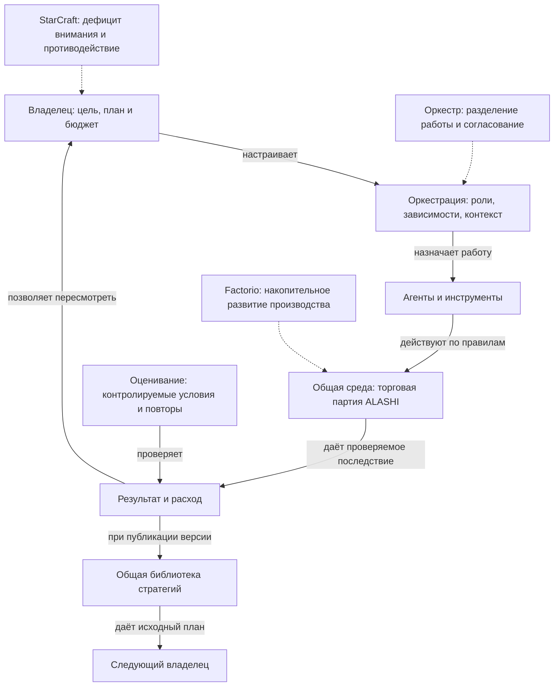

# ALASHI, Brood War и оценка оркестрации агентов

19 октября 2026. Исследование по первоисточникам и локальному коду `523e14ac058a58ff25bc4786407fbb8bd60105fe`. Изменения игры и новые обращения к моделям не выполнялись. Статусы: observed означает проверенное здесь наблюдение; source_defined означает описание автора источника; hypothesis и target означают предложенную интерпретацию и будущую проверку.

## Общая карта

Главный вывод: сравнение со StarCraft сохранило смысл для управления вниманием и соперничества. Для оценки агентов нужны отдельные ответы: кто получил лучший результат, за какую цену и благодаря какому компоненту системы. Найденные источники не подтверждают единую метафору, которой вся отрасль заменила StarCraft. Экономическая часть ALASHI ближе к Vending-Bench Arena; управление задачами можно сравнивать с исследованиями оркестрации. Это вывод сопоставления, статус hypothesis.

Отдельно собран [playbook Brood War](BROOD_WAR_PLAYBOOK.md). [Реестр источников](BROOD_WAR_AGENT_EVALS_20261019_SOURCES.md) указывает даты и версии источников, ограничения проверки.

## Январь 2026 и последующие ориентиры

| Хук | Дата | Что было существенно | Конкретный пример и инструмент | Что это позволяет понять в ALASHI |
| --- | --- | --- | --- | --- |
| Фабрика | 06.03.2025, первая версия FLE | Развитие проверяется через работающую производственную систему | [Factorio Learning Environment](https://arxiv.org/abs/2503.09617): планирование, программирование действий и ресурсные ограничения | Для ощущения накопительного роста нужны зависимости возможностей и последствия вложений |
| Партитура | 14.06.2025; v6 от 28.05.2026 | Музыкальная аналогия уже использовалась в технической работе до января 2026 | [AgentOrchestra](https://arxiv.org/abs/2506.12508v6): иерархический планировщик, специализированные агенты, версионируемые ресурсы TEA | «Дирижёр» имеет техническое содержание, когда определены роли и жизненный цикл |
| Доказательство | 09.01.2026 | Оценивание агента уже включало проверку последствий в среде с журналом действий | [Anthropic, Demystifying evals](https://www.anthropic.com/engineering/demystifying-evals-for-ai-agents): повторные попытки, разные проверяющие, состояние среды | Строгое оценивание существовало одновременно с игровыми метафорами |
| Поле внимания | 18.01.2026 | Тоби Лютке связал управление шестью агентами со StarCraft и ограниченным вниманием человека | [Исходная расшифровка David Senra](https://www.davidsenra.com/episode/tobi-lutke), фрагмент о разведке и переключении внимания между агентами | Владелец выбирает, где вмешательство изменит результат |
| Исполнение | 08.04.2026 | Сохранение состояния и восстановление требуют устройства runtime | [Anthropic Managed Agents](https://www.anthropic.com/engineering/managed-agents): session log отделён от harness и sandbox, аналогия с интерфейсами ОС | Движение исполнителя должно соответствовать состоянию настоящей задачи |
| Менеджер | 30.06.2026, препринт | Умение управлять командой пытаются измерять отдельно от силы исполнителей | [ClawArena-Team v1](https://arxiv.org/html/2606.31174v1): фиксированный пул работников, выполнение проверяется программно | Сравнение владельцев требует контролировать состав команды |
| План | 28.07.2026, препринт | Граф работы можно изучать отдельно от исполнения | [OrchBench v1](https://arxiv.org/html/2607.25656v1): заданный DAG, передача информации и детерминированная симуляция | Граф полезен для диагностики; симуляционные токены не являются счётом провайдера |
| Калибровка | 28.08.2026 | Даже сама среда проверки меняет оценку | [Terminal-Bench 4.0](https://www.tbench.ai/news/terminal-bench-4-0): поправки задач и вычислительных лимитов, удаление насыщенных задач | Версия среды и её ресурсы должны сопровождать рейтинг |
| Работа | 08.09.2026 | Проверяющий тоже может награждать нежелательный способ ответа | [APEX-Agents 1.1](https://www.mercor.com/blog/introducing-apex-agents-1-1/): исправление scattergunning, экспертный аудит | Формальное попадание в критерий ещё не означает полезный результат |
| Соперник | 25.09.2026, технический отчёт | Для разных игр используют разные метрики и оценивают неопределённость | [Kaggle Game Arena](https://arxiv.org/html/2609.31473v1): шахматы, покер, Werewolf | Единый рейтинг без учёта устройства игры может смешать разные навыки |
| Пространственный интерфейс | 30.09.2026, публикация автора Ralv | Январская RTS-метафора продолжилась в интерфейсах виртуального офиса | [Dominik Scholz](https://dipl.ing/blog/the-provenance-crisis): январские посты и сентябрьские офисы агентов | Внешний вид интерфейса сам по себе не подтверждает качество управления |

Январское воспоминание подтверждается двумя первичными свидетельствами: исходным интервью Лютке и ретроспективой создателя Ralv с январскими постами. Конкретный твит, который видел Амир, не установлен. Прямое чтение найденного X-адреса не удалось. Нельзя объявлять Лютке первым автором сравнения или оценивать распространённость идеи по этой выборке.

Дата отчёта Game Arena также не означает, что в нём испытаны модели октября: авторы фиксируют выбор моделей на февраль 2026. Более поздняя публикация может описывать более ранний эксперимент.

## Playbook Brood War рядом с текущей ALASHI

| Механизм | Brood War | ALASHI в проверенном коде | Граница соответствия |
| --- | --- | --- | --- |
| Доход и расход | Рабочие добывают минералы; вложения увеличивают доступное производство | Фракция производит товар и торгует. Расход модели учитывается отдельно в strategy run | Кристаллы представляют токены модели, но производство товара не пополняет API-бюджет |
| Исполнители | Рабочие и боевые юниты имеют состояние и функции в мире | Фракция является экономическим участником. Узлы плана вызывают модель или локальный инструмент; Degenie показывает работу | Нарисованный робот не становится самостоятельным игровым рабочим с добычей |
| Развитие | Технологические предпосылки открывают новые возможности | План содержит до восьми задач с зависимостями; правила торговли и политики задаются отдельно | DAG работы ещё не является деревом технологий или обучением агента |
| Разведка | Наблюдение ограничено; сведения о противнике требуют действий | Торговый challenge захватывает публичное состояние; библиотека раскрывает опубликованные версии | Общего RTS-тумана войны нет. Скрытая сдача рекламы решает другую задачу |
| Параллельность | Экономика и боевые действия продолжаются между приказами | Независимые задачи запускаются одновременно; готовое продолжение не ждёт чужую ветку | Эта часть управления работой реализована |
| Время | Окно преимущества закрывается, пока соперник развивается | Есть цикл Market → Action → Law с дедлайнами; challenge не останавливает партию | Это фазовая игра с часами, а не полный непрерывный RTS-контроль |
| Пространство | Дистанция и позиции меняют условия боя. Видимость также зависит от местности | Результат сделки вычисляют правила экономики; путь Degenie его не меняет | Вся карта пока служит представлению действий |
| Противодействие | Состав сил и время атаки меняются по действиям соперника | Общая ценовая кривая меняется при торговле; влияние и голосования меняют экономические условия | Экономическое и политическое противодействие уже есть |
| Итог | В конкретной лиге определены победа, вычислительные лимиты и допустимые наблюдения | Базовая партия длится шесть раундов; settlement и task challenge имеют разные критерии | Токен-лидер отдельного действия не равен победителю всей партии |
| Повторное использование | Бот-лиги допускают улучшение предыдущих работ при соблюдении условий | Версии имеют parent; производную публичной стратегии нужно опубликовать до применения | Публикация и учёт reuse работают внутри платформы. Лучший результат следующего владельца ещё надо измерить |

Правила StarCraft подтверждены [Blizzard Compendium](https://classic.battle.net/scc/gs/) и [регламентом SSCAIT](https://sscaitournament.com/index.php?action=rules). В SSCAIT поощряют улучшение прежних ботов с раскрытием происхождения; сама идея повторного использования имеет предшественников. Этот регламент не доказывает наличие аналогичного публичного copyleft-механизма в любой лиге.

Основания ALASHI: [фазы и состояние](../../rules/src/state.rs), [константы](../../rules/src/constants.rs), [действия](../../rules/src/actions.rs), [цены и settlement](../../rules/src/logic.rs), [strategy cycle](../../arena/src/strategy_cycle.rs), [исполнитель графа](../../tools/agent-bootstrap/strategy-run.mjs), [правила дуэлей](../../tools/agent-bootstrap/STRATEGY_DUELS.md). Код исследован локально. Это не проверка развёрнутой версии сайта.

### Проверенный пример: одинаковое действие и разные результаты

В [сохранённой приёмке торгового цикла](../../experiments/alashi-watch/trading-strategy-cycle/ACCEPTANCE.md) обе стороны произвели по два товара. При продаже двух товаров одна получила 22 игровых alashi, другая 17. Причина видна в общей кривой: первые два значения равны 12 и 10, следующие 9 и 8, при нулевых модификаторах и налоге. Порядок исполнения изменил цену. Этот эпизод не доказывает превосходство плана, который получил 22.

Та же приёмка содержит 360 и 120 синтетических токенов TEST-провайдера. Это проверка учёта. Денежная экономия на реальных моделях там не измерялась. Usage поступает от владельца как provider receipt, независимой аттестации провайдера нет. Неизвестный расход не считается нулём. Нулевая величина model tokens у локального инструмента ничего не говорит о его комиссии или вычислительной цене.

В этой работе повторно разобраны восемь сохранённых runs из [public-cycle.json](../../experiments/alashi-watch/trading-strategy-cycle/public-cycle.json). Суммы usage совпали с 360/120; значения 22/17 пересчитаны по `PRICE_TABLE` из правил. У всех runs стоит TEST-метка, в fixture записано ноль внешних обращений к моделям. Это повторная проверка архивных данных.

Заново запущены только локальные тесты планировщика: `node --test tools/agent-bootstrap/strategy-scheduler.test.mjs`, 15/15 passed. Они проверяют запуск готового продолжения, резервирование, остановку после ошибок и восстановление сохранённых ответов без повторного обращения к модели. Внешних запросов к моделям: 0. Историческая торговая приёмка, свежая Solana-партия и участие двух независимых людей в этой работе не воспроизводились.

## Что сейчас оценивают

Оценка относится к системе `модель + инструкции + инструменты + память + runtime + условия`. Для сравнения отдельных компонентов остальные условия приходится фиксировать. Это следует из определения agent harness у [Anthropic](https://www.anthropic.com/engineering/demystifying-evals-for-ai-agents).

| Вопрос | Первичный референс | Как подтверждают результат | Что брать в ALASHI и где ограничение |
| --- | --- | --- | --- |
| Сделана ли работа в среде? | [Terminal-Bench 4.0](https://www.tbench.ai/news/terminal-bench-4-0) | Проверяемое выполнение задач; калибровка среды | Принятое действие и изменённое состояние важнее сообщения об успехе. Лимиты и версия обязательны |
| Решена ли профессиональная задача? | [APEX-Agents 1.1](https://www.mercor.com/blog/introducing-apex-agents-1-1/) | Рабочие материалы, экспертные критерии и откалиброванный judge | Для маркетинга нужен результат по brief. Его творческая приёмка ещё не устанавливает конверсию |
| Стабильно ли соблюдается процесс? | [τ-bench, текущий репозиторий](https://github.com/sierra-research/tau2-bench) | Симуляция клиента с инструментами и политиками; в текущем README уже τ³-bench с voice и knowledge | Повторы и версия проверяющего. Исправления grading меняют сопоставимость результатов |
| Хорошо ли управляют командой? | [ClawArena-Team](https://arxiv.org/html/2606.31174v1) | Один пул работников для всех управляющих; выполнение и права проверяются программно | Ближайший пример изоляции управления. Это тест LLM-менеджера, не исследование навыка человека; код и данные в v1 обещаны к выпуску |
| Правильно ли устроен план? | [OrchBench](https://arxiv.org/html/2607.25656v1) | Симуляция назначения задач с учётом контекста и передачи результатов | Позволяет искать потерянные зависимости. Декомпозиция заранее задана; качество и расход являются моделируемыми величинами |
| Умеет ли агент вести дело против конкурентов? | [Vending-Bench Arena](https://andonlabs.com/evals/vending-bench-arena) | Общая торговая среда с перепиской; сделки отражаются в индивидуальных балансах | Близкий референс торговле ALASHI. Оценка результата команды не выделяет вклад её владельца |
| Как меняется игра при разных наблюдениях и ролях? | [Kaggle Game Arena](https://arxiv.org/html/2609.31473v1) | Шахматы: Bradley-Terry/Elo; покер: BB/100; Werewolf: роль-зависимая оценка. Авторы публикуют интервалы и матчевые данные | Для законов и коалиций нужны проверки состава и соперников с учётом роли. Шахматный рейтинг нельзя автоматически переносить на политическую экономику |
| Насколько длинную задачу решают надёжно? | [METR Time Horizons](https://metr.org/time-horizons/) | Вероятность успеха относительно длительности работы человека-эксперта | Это не длительность автономного запуска. Домены преимущественно программные; страница обновлена 08.09.2026 и больше активно не поддерживается |
| Какой результат покупает бюджет? | [METR Expenditure Horizon](https://metr.org/blog/2026-07-21-expenditure-horizon/) | Кривые результата от совокупного расхода, повторная проверка улучшений | Считать также эксперименты и труд человека. Метод применён к NanoGPT; его числа не переносятся на ALASHI |
| Сохраняется ли полезность под атакой? | [AgentDojo](https://agentdojo.spylab.ai/) | Проверки utility и атак через prompt injection | Чужая стратегия и сообщения соперника требуют отдельной проверки границ полномочий. Победа не служит оценкой безопасности |

Для надёжности различают pass@k, успех хотя бы одной из k попыток, и pass^k, устойчивое прохождение повторов. Нельзя оплачивать k попыток и показывать расход только удачной. Источник определения и применения повторов: [Anthropic](https://www.anthropic.com/engineering/demystifying-evals-for-ai-agents). В ALASHI стоит показывать весь расход серии, долю успеха и распределение результата; конкретный протокол ниже является target.

Токены и деньги требуют отдельных измерений. В [Vending-Bench 2](https://andonlabs.com/evals/vending-bench-2) одновременно есть симуляционный баланс бизнеса, фиксированный внутри среды штраф за output tokens и оценка API-цены запуска. Эти величины имеют разный смысл. «Год бизнеса» там также является годом симуляции. Для ALASHI нужен такой же явный разбор счетов, без приравнивания игровых alashi к реальным расходам.

Работа [Towards a Science of Scaling Agent Systems, v3 от 08.04.2026](https://arxiv.org/abs/2512.08296v3) сравнивает 260 конфигураций при контроле условий. Выигрыш от нескольких агентов зависит от структуры задачи; последовательные и насыщенные инструментами задачи могут проигрывать из-за координационных издержек. Это свидетельство против утверждения «чем больше агентов, тем эффективнее». Результат авторов ограничен их наборами задач и архитектурами.

## Дирижёр из исследований владельца

Прочитаны оригиналы «Дирижер ИИ-агентов: Аналогия и практика» и «Техническое исследование дирижера и кода», включая раздел «Анатомия ферматы». Их полные тексты остаются локально. Во втором документе библиография содержит даты обращения 27 февраля 2026; это не установленная дата публикации самого исследования.

| Музыкальный образ | Техническое содержание | Что проверять |
| --- | --- | --- |
| Партитура | Цель задаёт роли и зависимости; результат имеет критерии приёмки | Исполнителю хватает нужного контекста; роли не дублируют работу без причины |
| Музыкант | Специализированный агент или инструмент | Его результат пригоден следующему участнику |
| Дирижёр | Координация вступлений, обратная связь и решение об изменении исполнения | Вмешательство уменьшает ошибку или устраняет задержку |
| Репетиция | Прогоны плана с разбором и сохранением версии | Улучшение повторяется на новых условиях |
| Фермата | Приостановка конкретного workflow до внешнего решения | Состояние сохраняется; продолжение не дублирует внешний эффект |

У ферматы есть прямой технический механизм: [LangGraph interrupts](https://docs.langchain.com/oss/python/langgraph/interrupts) сохраняют состояние через checkpointer и возобновляют выполнение по внешнему вводу. При продолжении узел запускается заново, поэтому операции перед прерыванием требуют аккуратного устройства. [Temporal](https://temporal.io/blog/robust-message-handlers) отдельно разбирает обработку внешних сообщений и конкурентность обработчиков. Эти документы подтверждают конкретные механизмы; они не устанавливают, что любой оркестратор автоматически надёжен.

Для ALASHI пауза одной команды и пауза всей арены имеют разный смысл. Владелец может задержать собственное решение, пока игровой дедлайн продолжает идти. Нельзя обещать одновременно неограниченное ожидание человека и сохранение его игрового окна без отдельного правила.

Музыкальная аналогия подходит для согласования разных исполнителей. Ей не хватает конкурента и объективной функции победы. Она также не доказывает обязательность единственного центрального управляющего: [описание процесса Orpheus от Deutsche Grammophon](https://www.deutschegrammophon.com/en/artists/orpheuschamberorchestra/news/orpheus-chamber-orchestra-present-their-complete-recordings-on-deutsche-grammophon-263131) показывает коллективное руководство и сменяемые роли. Утверждения локального исследования о неизбежном хаосе без дирижёра следует считать чрезмерными.

Человек может задавать замысел, LLM может распределять задания, а детерминированный scheduler может отслеживать готовность и права. Слово «дирижёр» не должно скрывать эту разницу ответственности. В ALASHI сейчас владелец выбирает план, а scheduler исполняет его зависимости. Автоматическое улучшение стратегии или обучение модели из этого не следуют.

## На что это похоже сейчас

| Референс | Что объясняет | Когда он вводит в заблуждение |
| --- | --- | --- |
| StarCraft | Ограниченное внимание владельца, окно решения, адаптацию к сопернику | Если декорация выдаётся за добычу, туман войны и настоящее дерево развития |
| Оркестр | Специализацию и согласованное исполнение | Если согласие команды принимается за правильность результата |
| Factorio | Накопительное развитие и зависимости производства | Если каждый раунд начинается заново и вложения ничего не открывают |
| Операционный центр / runtime | Задачи с правами и бюджетом; журнал для восстановления | Если надёжный scheduler принимается за разумность выбранной стратегии |
| Турнир с проверяемыми результатами | Соревнование при заданных условиях и постепенное улучшение | Если место в турнире называют универсальным интеллектом агента |

Это аналитическое сопоставление, hypothesis. Оно не является измерением популярности метафор. Для ALASHI можно сохранить StarCraft как язык управления и наблюдения, а качество подтверждать протоколом соревнования. Следующий владелец должен получить применимую версию плана с доказательствами её границ.

## Предлагаемый протокол ALASHI: что именно сравниваем

Статус этого раздела: target. Протокол не реализован и не запущен в рамках исследования.

| Режим проверки | Что фиксируем | Что меняем | Допустимый вывод |
| --- | --- | --- | --- |
| Навык управления | Модели работников и инструменты; исходное состояние и лимиты бюджета | Владельца и выбранный им план | Разница связана с управлением при данных исполнителях; нужен учёт времени и помощи человеку |
| Сила исполнителя | План с инструментами; состояние и лимиты | Модель | Сравнивается модель внутри данного harness |
| Открытая арена | Общие правила задания и потолок бюджета | Владелец выбирает всю команду | Победила система целиком; вклад человека и модели по отдельности не установлен |

Для двух человеческих владельцев нужны повторные задания и смена условий. Одно противостояние двух разных людей с разными моделями не позволяет отделить влияние владельца от его команды. Если ресурсов достаточно, перекрёстная проверка, где оба человека используют каждый из фиксированных пулов работников, покажет зависимость результата от их сочетания. Обучение человека по ходу серии также надо учитывать порядком заданий.

Начальная проверка ограничивается существующей торговлей. Для сравнения расхода на одно действие использовать независимые копии одинакового состояния и одинаковый проверенный результат. Для стратегической силы провести полные партии с зафиксированной политикой и перестановкой сторон и порядка, с учётом доступных ролей. Общую ценовую кривую сохранить в соревновательном режиме; не объяснять её эффект токен-экономией.

Полезные минимальные сравнения: детерминированная эвристика, один агент, исходный план и его производная. У всех должны быть одинаковые наблюдения и разрешённые действия. Сначала проверить законность и одинаковость результата; затем сравнить цену. Для серии предварительно определить число партий по ожидаемой вариативности и нужной точности, сохранить все попытки и оценить интервалы по целым партиям. Кадры одного replay не являются независимыми наблюдениями.

### Что записывать

| Измерение | Свидетельство | Ограничение |
| --- | --- | --- |
| Результат | Принятый game event, состояние после действия, итог партии | Текст агента не подтверждает исполнение |
| Токены | Provider request ID и usage input/output; cache и reasoning по схеме провайдера | Категории могут перекрываться; не складывать их дважды. Токенизации разных моделей различаются |
| Деньги | Датированный тариф, фактически тарифицируемые категории, комиссии инструментов и вычисления | Неизвестный счёт остаётся unknown. Бесплатная модель может расходовать токены |
| Время | Начало и конец вызовов, готовность зависимостей, дедлайн, критический путь | Ускоренный replay не измеряет скорость исполнения |
| Управление | Публично проверяемые команды владельца и время вмешательства | Не требуется раскрывать скрытые рассуждения модели |
| Надёжность | Неуспехи, повторные попытки, сбои инфраструктуры, пропущенные ходы | Исключение неудач из знаменателя завышает результат |
| Происхождение | Версия с parent; модель и harness; rules commit и seed; состав соперников | Кошелёк не устанавливает уникального человека |

Схема расчёта денег: `model cost = сумма(непересекающиеся тарифицируемые единицы × тариф категории)`, затем отдельно добавить инструменты и инфраструктуру. При необходимости показать стоимость времени владельца отдельным предположением. Игровая прибыль и реальные деньги остаются разными осями.

Утверждение об экономии допустимо после проверки качества на общем наборе. Например, сравнивать полный расход A и B при одинаковом результате и доле успешных попыток; показать интервал разницы и цену неудач. При разном качестве или времени показывать границу Парето: варианты, для которых нет другого одновременно дешевле и лучше. Выбор минимального числа токенов без проверки результата поощряет отказ от полезной работы.

### Публичная польза и следующий владелец

Проверка вклада в общее благо: владелец C получает опубликованную производную B и запускает её на отложенных состояниях, которые не использовались при улучшении. Контрольная группа получает исходный план A при тех же возможностях. Измеряются качество, полный расход и усилие настройки. До проверки задан допустимый порог ухудшения качества. Если B помогает только автору на знакомом эпизоде, перенос пользы не подтверждён.

Работающий fork и один reuse показывают механизм передачи. Сетевой эффект потребует наблюдения, что дополнительные полезные участники и версии повышают ценность для других владельцев, при учёте качества отбора и сложности поиска. Сам рост числа кошельков этого не доказывает. Принудительная публикация также не гарантирует полезность каждой версии.

У пользователя остаётся выбор приватности исходной стратегии. Внутреннее правило публикации производной не может установить ручное копирование вне ALASHI. Юридическое лицензирование в этой работе не исследовалось.

## Поправки к прежним исследованиям ALASHI

В [EVAL_METHODOLOGIES](EVAL_METHODOLOGIES.md) есть полезные направления, которые требуют более узкой формулировки. OpenSkill оценивает относительный ранг при заданной модели; распределение выплат 50/30/15/5 не превращается автоматически в учёт экономической полезности. Shapley для решающего YES-голоса относится к выбранной функции прохождения закона, а не ко всей пользе участника. Статистическая зависимость сообщений и действий сама по себе не доказывает сговор или причинность.

Код [sim_metrics.py](../../tools/sim_metrics.py) уже оставляет Rationality Gap недоступным: без независимой модели допустимых альтернатив прежняя оценка была тавтологией. Этот пример показывает нужный стандарт: отсутствие основания должно оставаться явным. Новые сравнения следует строить с зафиксированной функцией выигрыша и независимой проверкой альтернатив.

## Готовность и оставшиеся пробелы

Observed: прочитаны локальные исследования, проверены первичные публикации, составлен playbook, сравнены текущие правила и исполнитель графа, прошли 15 локальных тестов scheduler. Новые документы не утверждают доказанную реальную экономию или сетевой эффект.

Not_validated: конкретный январский твит Амира, распространённость метафор во всей отрасли, независимое воспроизведение результатов внешних исследований, живая партия Brood War, актуальное развёртывание исследованного кода, свежий полный цикл двух внешних владельцев и реальные счета моделей. Эти пробелы не закрываются иллюстрацией или одной удачной тестовой партией.
