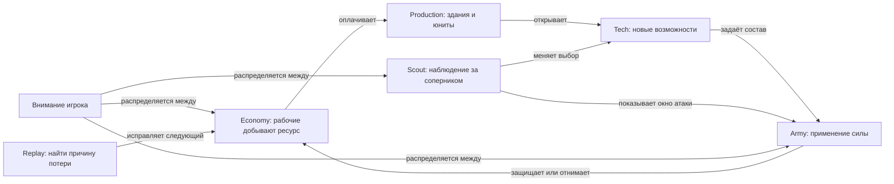

# StarCraft: Brood War: playbook для разбора ALASHI

19 октября 2026. Статус: source_defined для правил Blizzard, hypothesis для переноса в ALASHI. Это составленный по первоисточникам рабочий конспект. Он не является официальным документом с названием Playbook или обзором соревновательной меты 2026 года.

## Карта партии

Два процесса идут одновременно: игрок поддерживает производство и меняет решения по новой информации. Уже отданные приказы продолжают исполняться. Источники: Blizzard, [Resources](https://classic.battle.net/scc/gs/res.shtml), [Reconnaissance](https://classic.battle.net/scc/GS/recon.shtml), [управление группами и очередями](https://classic.battle.net/scc/gs/control.shtml).

## Что делать и зачем

| Хук | Решение игрока | Что проверять в партии | Что становится возможным дальше |
| --- | --- | --- | --- |
| Доход | Обеспечить добычу рабочими и расширять экономику, когда это оправдано | Доход, простаивающие рабочие, расстояние до залежей, насыщение добычи | Можно оплачивать производство. Дополнительный рабочий полезен, пока есть работа |
| Пропускная способность | Подготовить supply и мощности производства к следующему расходу | Ресурсы накопились, но нужный юнит не производится: чего не хватает? | Доход превращается в доступные действия |
| Разведка | Потратить часть возможностей на наблюдение | Какие здания и силы действительно увидены? Насколько сведения устарели? | Можно отличить угрозу от предположения и изменить план |
| Развилка | Выбрать развитие по увиденному, с учётом цены задержки | Что покупаем сейчас и от какой альтернативы отказываемся? | Возникает нужный состав армии, обнаружение или защита |
| Окно | Использовать преимущество, пока соперник не закончил ответ | Готовность своих сил, путь до цели, оборона противника | Более ранняя готовность приносит результат |
| Макро во время микро | Продолжать развитие во время локального боя | Не остановилось ли производство из-за внимания к одной стычке? | Локальная победа подкрепляется следующими силами |
| Пересмотр | Обновить сведения и пересобрать решение | У соперника появилась новая технология или база? | Успешное открытие не превращается в слепое повторение |
| Разбор | Найти первое решение, после которого возникло отставание | Добыча, простой, неувиденная угроза, неудачный бой | Следующая версия плана исправляет конкретный сбой |

Экономические ограничения описаны в [Resources](https://classic.battle.net/scc/gs/res.shtml). Разведку и разбор итоговой статистики описывает [Reconnaissance](https://classic.battle.net/scc/GS/recon.shtml). Необходимость продолжать производство во время атаки и учитывать расстояние до соперника видна в [Protoss Strategy](https://classic.battle.net/scc/protoss/astrat.shtml). Это старые учебные рекомендации Blizzard; их точные rush-тайминги здесь не принимаются за современную мету.

Build order задаёт порядок вложений и условия перехода. Для переноса в ALASHI его полезно записывать так: «после подтверждения X выполнить Y; если наблюдается Z, выбрать другую ветку». Конкретные supply-числа зависят от расы и открытия, с учётом карты. Без выбранного matchup универсальная последовательность была бы ложной точностью.

## Конкретная развилка: нужен Observer

Учебный пример: игрок Protoss подозревает скрытую угрозу и решает вложиться в мобильное обнаружение. Ветка развития должна довести его до Robotics Facility и Observatory, после чего Observer производится в Robotics Facility. Игрок платит за эту возможность ресурсами и временем, которые мог бы потратить на другие силы. Сам Observer помогает обновить сведения; его наличие ещё не выигрывает бой. Требования и назначение подтверждаются страницами Blizzard: [Observer](https://classic.battle.net/scc/protoss/units/observer.shtml), [Observatory](https://classic.battle.net/scc/protoss/popup/observatory.htm).

Для ALASHI здесь полезна причинная структура: вложение открывает действие, действие приносит сведения, сведения меняют следующее решение. Иконка здания без такого изменения доступных действий передаёт только внешний вид.

## Управление вниманием

Группы и горячие клавиши позволяют выбрать нужный участок работы; очереди команд освобождают внимание после приказа. В Brood War группа включает до 12 юнитов. Приказ рабочему «построить, затем добывать» является настоящей очередью действий. Это объясняет, почему человеку не требуется непрерывно управлять каждой единицей. Источник: [Hot Keys and Special Commands](https://classic.battle.net/scc/gs/control.shtml).

Пространство тоже влияет на результат: возвышенность меняет видимость и условия боя. Поэтому карта StarCraft является частью вычисления исхода. В ALASHI маршрут Degenie пока не меняет цену сделки или законность действия. Источник правил местности: [High Ground and Cover](https://classic.battle.net/scc/gs/hc.shtml); граница ALASHI разобрана в [сравнении](BROOD_WAR_AGENT_EVALS_20261019.md).

## Как смотреть replay

Начать с наблюдаемого проигрыша, затем пройти назад до проверяемого решения. Пример вопроса: «армия погибла без обнаружения, потому что игрок не увидел угрозу, поздно выбрал технологию или не довёл уже выбранную ветку до результата?» Эти причины требуют разных изменений playbook.

В ALASHI аналогом служит путь `версия стратегии → задача → вызов → usage → принятое действие → изменение состояния`. Красивый проход робота не заменяет запись принятого действия.

## Материалы для самостоятельной работы

- [Blizzard StarCraft Compendium: Strategy Central](https://classic.battle.net/scc/gs/): вход в правила и учебные разделы компьютерной игры.
- [SSCAIT: правила соревнования ботов Brood War](https://sscaitournament.com/index.php?action=rules): ограничения наблюдения и вычислений; правила пауз и проверка результата по replay. Это конкретный регламент лиги, а не правила любого человеческого матча.
- [SMACv2](https://github.com/oxwhirl/smacv2): исследование децентрализованного микроконтроля в StarCraft II. Его результаты нельзя выдавать за проверку всей экономики Brood War или управления LLM-командой.

Официальный PDF руководства не удалось получить из-за ошибки сертификата на сервере загрузки. Ссылки выше открылись при проверке. Локальная партия Brood War и просмотр её replay в этой работе не выполнялись.
