# Alashi: сделать баттл интересным для зрителя

Исторический материал предыдущего прохода. Упоминания распределения работы между Иваном и Дином не задают текущие обязанности; с 16.10.2026 проект ведут Амир и Codex.

16.10.2026. Разбор по ambitious-work. Основа: пакет Амира, отправленный Ивану 15.10, и просмотр игры. Статусы ниже отделяют наблюдения, требования владельца и предложения.

## Решение

hypothesis: интерес возникнет, когда зритель сможет выбрать сторону, заметить расхождение стратегий и дождаться последствия. Само количество движущихся субагентов этого не обеспечивает. В первой реализации стоит довести один законченный баттл с понятным результатом. Переносимую репутацию можно подключить после проверки того, что за таким баттлом хочется наблюдать.

target владельца сохранён: два Chief of Staff, рои в противоположных частях карты, Degenie, общий рынок и парламент. Политэкономическая игра Alashi сохраняет свои правила. Игровые деньги, расход модели и репутация имеют разные значения.

observed: подготовлен [интерактивный эпизод](index.html). Он использует неизменённый рисунок из серверного пакета и новый учебный сценарий 159:102. Сигналы поручений движутся между узлами, а персонажи остаются частью статичного изображения. Это режиссёрский макет; 3D-сцена и реальные рои в нём не реализованы.

## Карта всего пути

```mermaid
flowchart LR
  A[Вход: выбрать сторону] --> B[Общая цель и равный старт]
  B --> C[Штаб поручает работу]
  C --> D[Исполнитель приносит ответ]
  D --> E[Штаб выбирает действие]
  E --> F[Подтверждённое действие]
  F --> G[Видимое последствие]
  G --> H[Развязка партии]
  H --> I[История конкретного исполнителя]
  I --> J[Следующий баттл]
  C -. работа роя .-> K[События задач и инструментов]
  F -. игровое основание .-> L[Журнал игры]
  K --> D
  L --> G
```

Текущий участок: постановка B → I. Переход на реальный поток K → L остаётся работой команды. Существующий игровой журнал не даёт основания дорисовывать выдуманные поручения.

## Как применён скилл

| Направление | Решение этого прохода |
| --- | --- |
| Высота | Конечная цель задана Амиром: интересно смотреть. Проверка строится вокруг понимания выбора и желания увидеть продолжение. Красота отдельного кадра остаётся частью задачи. |
| Глубина, основной акцент | Прочитан сам серверный пакет, сверены хеши, просмотрены макет и главная игры, проверены правила расчёта и поля событий в коде. Использован канон Лассетера. |
| Широта, основной акцент | Применены приёмы спортивной трансляции. Табло сохраняет положение сторон, крупный план выделяет главное действие. Развязка получает отдельный разбор. Действию предшествует подготовка; затем показывается последствие. |
| Скорость | Взяты существующий рисунок, учебный пример и игровые правила. Проверка постановки выполнена до затратной сборки всей новой 3D-арены. |

Методы использованы в работающем макете. Самооценка автора не считается доказательством зрительского интереса.

## Что найдено при просмотре

observed: серверный пакет находится в `/home/ubuntu/amir-alashi-swarm-20261015-01a13c93/`. ID передачи: `ALASHI-SWARM-REPUTATION-AMIR-20261015-01`. Исходный docs SHA: `982cb0c310c8abc180e0155cc0b328963f714795`. При чтении центральных документов HEAD был `ff1792d544693c8dc5fa38d3441ca2e7a8fdf065`. В проверенных BOARD и handoff Ивана ACK и продуктовый вердикт не найдены. Отправка пакета не означает принятие в реализацию.

observed: исходный автономный макет открывается сразу в фазе рынка, раунд 3/6. Есть ручное переключение четырёх фаз и карточки групп. Его последний счёт 144:80 относится к прежнему примеру. В документе пакета уже другой сценарий: последний раунд, продажи обеих сторон, итог 159:102. Исходник сохранён без правок в [source](source/alashi-two-sides-preview.html).

| Участок | Наблюдение | Применение в макете | Что принимать в игре |
| --- | --- | --- | --- |
| Первый экран | В исходнике задача сформулирована как выбор экономического хода и голоса; критерий победы не выделен. | Общая цель: у кого останется больше денег. Начало с равных ресурсов. | Зритель может назвать стороны и критерий победы без вводного рассказа. |
| Работа роя | Карта статична. Связь меняется по клику, поручения описаны карточками ниже. | Доставка поручения и ответа показана сигналом на поле; подробности открываются отдельно. | Виден адресат поручения; можно открыть его задачу и статус. Отсутствующий ответ показан как ожидание. |
| Конфликт | Ручные фазы сразу заменяют числа. Момент расхождения легко пропустить. | А продаёт раньше, Б получает меньшую выручку. Счёт меняется при прибытии сигнала исполнения. | Действие, его подтверждение и последствия читаются отдельно. |
| Развязка | Макет заканчивается на законе, без завершённой партии. | Победа Б в голосовании сопоставлена с денежной победой А. | Финал объясняет решающий эпизод и использует итоговые события игры. |
| Репутация | В документе замысел есть, в макете нет проверенной истории. | Показано различие между верным расчётом аналитика Б и неудачной целью штаба. | У оценки указана роль конкретной версии исполнителя; доступно доказательство. |
| Телефон | При ширине 390 поле имеет высоту около 201 px; кнопки ролей убраны с поля. Список поручений расположен ниже. | Общая карта дополнена крупным фрагментом текущей области; обе стороны остаются на табло. | Главный жест и его адресат видны без увеличения всей страницы. |

observed: главная опубликованной игры показывала подтверждённый replay с 72 событиями. В браузере этой проверки WebGL недоступен, поэтому сцена перешла на резервное изображение и журнал. По этому просмотру нельзя оценить выразительность существующей 3D-анимации или объявить её сломанной. Chrome для отдельной проверки не был доступен.

## Один законченный эпизод

source_defined: за основу взят раздел 3 [переданного документа](source/ALASHI_SWARM_BATTLE_REPUTATION_2026-10-15.md). Условия: Classic, последний раунд 6/6, по 100 денег, 4 товара, 2 влияния; пустой рынок, налог 0, без сдвига цен и boom. В голосовании вес равен влиянию, вето отсутствует. Налоговая карта раскрывается только в Law.

| Момент | Что должен заметить зритель |
| --- | --- |
| Старт | Оба штаба имеют одинаковые игровые ресурсы. Размеры роёв различаются. |
| Поручения | Штабы выбирают, какую работу запросить. Субагенты не совершают независимый игровой ход. |
| Ответ А | Расчёт 39 готов. Полученный ответ ещё не меняет деньги. |
| Продажа А | На 14-й секунде Market проданы 4 товара по 12+10+9+8. Баланс 139. |
| Продажа Б | На 23-й секунде Market проданы 4 товара по 7+6+5+4. Баланс 122. |
| Action | А пропускает действие. Б передаёт А 20 денег и получает 4 влияния. Балансы 159:102. |
| Law | Открывается налоговая карта. Б голосует за, А против. Закон проходит 6:2. |
| Конец | Следующего рынка нет. Денежный итог остаётся 159:102. |
| Разбор | Верный расчёт конкретного субагента не оправдывает любой выбор его штаба. |

observed: арифметика повторно рассчитана по PRICE_TABLE из текущего проверенного main. Суммы 39 и 22, перенос 20 и итог 159:102 согласуются; см. [arithmetic.json](evidence/arithmetic.json). Проверены реализации продажи и BRIBE. Кодовые файлы чтения совпали с `fc40c653c7f109147716130d0bb1217971ff16c8`, который вернул свежий запрос remote main.

not_validated: 6 200/9 200 токенов и 42/55 секунд заданы авторским примером, а не получены из запуска. Общий учебный раунд длится 90 секунд. Монтаж макета длится 64 секунды. Эти шкалы явно подписаны.

## Что применить в реальной сцене

hypothesis: первый приоритет состоит в последовательной постановке одной продажи. Chief замечает ответ, принимает решение, направляет команду; исполнитель передаёт товар; после подтверждения меняются деньги; Chief реагирует на результат. На телефоне нужны видимые лицо и контакт. Текущую библиотеку игровых действий можно проверить на повторное использование, сохранив канон Лассетера.

hypothesis: роли лучше различать действием и реквизитом. Аналитик сравнивает показания терминала и возвращает расчёт. Проверяющий сопоставляет ответ с условием и принимает либо возвращает работу. Экономический исполнитель взаимодействует с товаром. Политический исполнитель приносит сведения из парламента. Один декоративный жест для всех ролей ухудшит различимость.

hypothesis: камера удерживает общую карту, а важное действие получает отдельный крупный план. Автоматическое движение всей камеры между десятками исполнителей заставит зрителя постоянно восстанавливать контекст. Одновременно на передний план выводится один смысловой момент; соседняя работа остаётся видимой на общем плане.

hypothesis: ожидание показывается содержательно: «ждёт ответ рынка», «проверяет расчёт», «повторяет запрос после ошибки». В прямом эфире ожидание не вырезается тайно. В повторе можно пропускать тихие интервалы с явной отметкой пропуска, сохраняя игровое время. В демонстрации нельзя объявлять завершение до соответствующего события.

hypothesis: повтор после партии должен возвращать к решающему моменту и давать открыть основание результата. Карьера Degenie может поддержать желание вернуться, когда в ней накопятся реальные работы. Рейтинг без истории происхождения оценок не объяснит зрителю, почему конкретному исполнителю доверять.

## Данные и существующие механизмы

observed: `frontend/src/devnet/client.ts` содержит `ChainEvent`: устойчивый id, подпись, slot, тип, игровые поля. В `playback.ts` уже сопоставлены `sold`, `bribe_given`, `vote_cast`, `law_result` и завершение. `liveAdditions` учитывает просмотренные id и полноту истории. Эти механизмы следует сохранить и использовать при интеграции.

observed: просмотренные `ChainEvent` и `GraphData` не содержат `parent_run_id`, `task_id` и событий выдачи/приёмки поручений. Существующий graph описывает взаимодействия игровых агентов и помечен как mock. Он не равнозначен дереву выполнения работ внутри штаба. Вывод относится к просмотренным контрактам main, а не ко всем возможностям внешних harness.

target для обсуждения с Иваном: связывать два вида записей. Первый вид описывает исполнение задачи: идентичность агента и его версия; run и task; родительская задача; отправитель и исполнитель; публичное назначение; время и состояние; результат; происхождение usage. Второй вид содержит подтверждённое игровое действие. Ссылка между ними должна быть явной. Названия полей и схема требуют согласования с действующим backend.

| Случай | Поведение для приёмки |
| --- | --- |
| Поручение выдано, ответа ещё нет | Показать ожидание и зависимость; не запускать сцену успеха. |
| Инструмент вернул ошибку | Показать неудачную попытку; повтор имеет собственное основание и затраты. |
| Ответ отклонён проверяющим | Вернуть работу исполнителю с публичной причиной; завершение не считать успешным. |
| Usage отсутствует | Показать «нет данных». Ноль означает известный нулевой расход. |
| Повтор доставленного события | Не повторять передачу денег и не создавать вторую оценку. |
| События пришли не по порядку | Восстановить порядок и зависимости; не показывать ответ раньше поручения. |
| Перемотка назад | Восстановить ресурсы этого момента; финальный баланс не подставлять в прошлое. |
| Отключено движение | Адресат и результат остаются видимыми. Переходы по моментам доступны. |
| Подключение потеряно | Сохранить последнее известное состояние и показать потерю связи. |
| Ничего значимого не происходит | Сохранить честное ожидание. Не придумывать конфликт ради зрелищности. |

Эта таблица задаёт приёмку будущей интеграции. Она не означает, что перечисленные сетевые случаи реализованы в локальном макете.

## Порядок реализации для команды

| Очерёдность | Конкретный результат | Проверка |
| --- | --- | --- |
| 1 | Один реальный баттл двух штабов с публичными событиями выдачи поручения и получения ответа. Выбранное действие связано с этими записями. | Каждый показанный результат связан с записью, а расход согласуется с исходными usage. |
| 2 | Один законченный эпизод на поле: подготовка, контакт, последствие, финал. | Просмотр без технического рассказа; все применимые принципы Лассетера, телефонный размер, кадры или запись. |
| 3 | Режиссура прямого эфира и повтора. Предусмотрены пауза и ожидание; ошибки видны. Пропуски тихих интервалов обозначены. | Повтор событий не создаёт новые действия; время и ресурсы восстанавливаются при перемотке. |
| 4 | Карточка исполнителя с историей проверенных работ. | Оценка роли отделена от победы штаба и имеет источник. |
| После этого | Решение о переносимой репутации, оплате внешних услуг и расширении арены. | Конкретная потребность подтверждена реальным использованием. |

source_defined: Иван отвечает за backend и контракт событий. Frontend с анимацией относятся к зоне Дина. В этом проходе их файлы не менялись, сообщения им не отправлялись, сайт не публиковался. Макет и разбор готовы для отдельной передачи по решению Амира.

## Проверка, способная опровергнуть предложение

Главное рискованное допущение: постановка придуманного удачного эпизода переносится на обычные партии. Один учебный пример подобран так, чтобы причина исхода была видимой. У настоящих агентов может оказаться одинаковая стратегия, много ожидания или результат без зрелищного поворота.

target следующего опыта: записать несколько обычных партий, заранее выбрав их до просмотра результатов. Включить партию без резкого перелома и запуск с ожиданием или ошибкой. Один фрагмент оставить для проверки после настройки постановки. Не делать вывод о качестве штабов из этого художественного опыта.

target зрительской проверки: дать пяти новым зрителям посмотреть эпизод на телефоне без объяснения правил автором. После просмотра попросить назвать победителя, показать момент изменения преимущества и объяснить, зачем были нужны исполнители. Затем предложить следующий эпизод без обязательства смотреть и наблюдать выбор. Зафиксировать места непонимания и остановки просмотра. Размер этой группы пригоден для обнаружения проблем, но не для оценки рыночного спроса.

Если люди читают пояснения, но не могут связать действие на поле с результатом, следующая правка должна касаться постановки и крупного плана. Если всё понимают, но продолжать не хотят, дополнительные подписи проблему не решат: нужно проверить характер персонажей, ставки конкретной партии и её темп. Если учебный эпизод нравится, а обычный нет, это аргумент пересмотреть выбор событий и режим трансляции.

## Проверки этого прохода

observed: JavaScript прошёл синтаксическую проверку Node. Полное автоматическое проигрывание дошло до 01:04 и остановилось с 159:102. Пауза сохранила время и положения сигналов. Возврат к началу восстановил 100:100, по 4 товара и скрыл финал. В режиме «Без движения» финал остался тем же. Карточки штаба Б открылись с его задачами; результат роли не выдаётся раньше соответствующего момента.

Доказательства: [проверки браузера](evidence/browser-checks.json), [кадр движения](evidence/motion-5.jpg), [финал полного проигрывания](evidence/playback-complete.jpg), [постановка по Лассетеру](STAGING.md). При ширинах 320 и 390 пикселей горизонтальной прокрутки нет. Исправлено кадрирование лица штаба Б. Снимки: [390 пикселей](evidence/after-phone-390.jpg) и [320 пикселей](evidence/after-phone-320.jpg). Проверки размеров сохранены в [responsive-checks.json](evidence/responsive-checks.json). [Самостоятельный файл](alashi-watch.html) проверен отдельно. Обе встроенные картинки загрузились. Итог и перемотка работают; см. [portable-checks.json](evidence/portable-checks.json). В [журнале браузера](evidence/console.json) нет ошибок и предупреждений.

not_validated: удовольствие зрителей, удержание, понимание новым человеком, частота кадров на физическом телефоне, реальные рои, сетевые ошибки, реальная репутация и 3D-контакты персонажей. Статичные персонажи в рисунке не проходят анимационную приёмку. Установлен работоспособный порядок показа; художественную выразительность новой 3D-сцены ещё предстоит реализовать и проверить.
