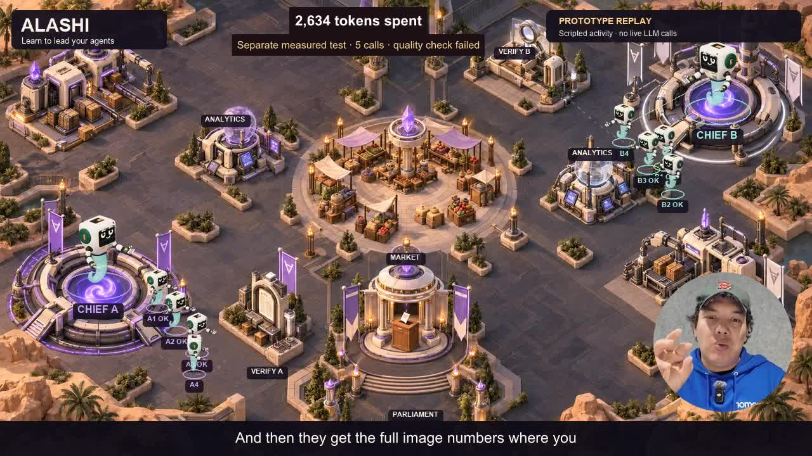

# ALASHI English founder demo: acceptance

Observed on 16 October 2026. The final file is `ALASHI-demo-english.mp4`.

## Media

- Duration: 120.000 seconds. Resolution: 1280 × 720. Frame rate: 30 fps.
- Independent PyAV decoding completed all 3,600 video frames and 5,760,000 audio samples without an error. Video is H.264; audio is AAC at 48 kHz.
- File size: 18,042,883 bytes. SHA-256 is recorded in `media-check.json`.
- A separate FFmpeg loudness pass measured the delivered audio at -15.60 LUFS integrated, -1.47 dBTP true peak, and 4.30 LU loudness range.
- The final output contains video and audio only. Source global metadata was stripped.

## Content and viewing

The original introduction is retained from source time 00:00.55 through 00:09.20. It includes “I'm a Tomorrow School student” and the founder's background. The opening is full frame; the rest uses his moving circular camera view. Speech is original English, with no synthetic dubbing. The first Russian recording informed context but is not heard in the film.

Selected speech is documented against the supplied transcript and local word timing in `edit.json` and `source-alignment.json`. All 34 speech cues are English and do not overlap. Names are corrected to ALASHI and Tomorrow School. Screen copy was checked with the owner's text cleaner, then reviewed for meaning and rhythm.

Browser playback reported duration 120, readyState 4, progressing currentTime and no media error. The introduction, moving map and the sharing section were reviewed. The circular camera remains outside the principal worker routes and above the subtitles. The UI spelling is ALASHI and faction letters are upright A/B.

The player was checked at presentation size and a 390 CSS-pixel page width, where the video is about 358 pixels wide. The whole map and camera remain visible. Small map labels require landscape/full-screen viewing; portrait playback is not a comprehension test. Browser sizing was restored after review.

## Motion and evidence

The approved terrain and original Degenie atlas are retained. Assignment cues precede departure; workers use curved routes with eased starts and stops. Work gestures precede returning report icons. These are UI receipts beside the characters, not physical objects held in their hands. The original atlas supplies face and smoke motion. Chiefs have distinct scale and placement. The complete sequence repeats with tasks running in parallel.

The offline schedule check covers 2,112 frames, all seven task phases and six simultaneous assignments. Verifiers cannot start until their three reports return. The browser runtime and original motion checks also pass. These checks supplement the visual review and the principle-by-principle direction in `DIRECTION.md`.

The map is labelled as a scripted prototype replay, with no live LLM calls. The 10,000-token allowance is labelled as an example. Five saved provider receipts independently sum to 2,634 tokens: 2,574 input and 60 output. That test failed its quality gate, which is stated on screen. No savings percentage is claimed. The sharing loop is presented as a product concept; network benefit is labelled as a goal.

New-viewer comprehension and physical phone performance have not been tested. The film does not demonstrate an independently reproduced winning strategy.

## Export recovery

The first composite failed when the disk ran out of space. It was not delivered. Reproducible caches and temporary alignment data were removed; raw camera recordings were preserved. The final compositor uses a separate short introduction input and a static circular alpha mask. The successful final file passed the complete decode check above.
