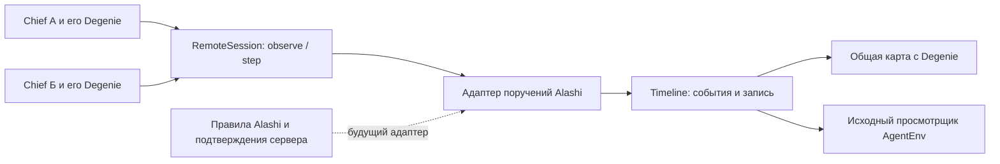

# Что берём для Alashi из двух примеров

Решение: использовать переносимый слой AgentEnv RTS для команд и записи наблюдений; оставить экономические правила Alashi и существующую модель Degenie. Локальный опыт проверяет эту границу.

## Проверенные исходники

source_defined: Warcraft-плагин [agentenv-wc3-plugin](https://github.com/earakely-scale/agentenv-wc3-plugin), commit 2376c509b6b5691858df2c9d4d1f79a7b1a877d1, лицензия Apache-2.0. Прочитаны README, session.py, timeline.py, live.py, viewer, участки server.py/worker.py и тесты транспорта. В vendor сохранены исходные RTS-модули с viewer и лицензией; SHA-256 находятся в evidence/vendor-hashes.json.

Перенесены конкретные модули, а не весь Warcraft-стек. RemoteSession обнаруживает расширения среды через её карточку и посылает HTTP-команды. Timeline хранит наблюдения и события. Контрольный viewer потребляет ту же запись без изменения. Персонаж взят из существующего desk-genie.glb. Для его загрузки используются SkeletonUtils и MeshoptDecoder из установленного frontend.

source_defined: для настоящего Warcraft нужны Legacy 1.29.2.9232, файлы владельца игры и x86-64 Linux с Wine/Docker. Режим fake моделирует движение юнитов и остановку; это не полноценный Warcraft. Его запуск не подтвердил бы механику Alashi. Плагин имеет stepping и realtime; для запроса Амира подходит realtime. Сам RemoteSession не создаёт часы: ими владеет среда.

source_defined: [OpenBW](https://github.com/OpenBW/openbw) и [BWAPI для OpenBW](https://github.com/OpenBW/bwapi) дают открытый runtime Brood War. Документация требует Stardat.mpq, Broodat.mpq, Patch_rt.mpq. Репозиторий именно C++-моста и четырёх инструментов из цитаты Perplexity не установлен. Не приписываем найденному OpenBW чужую демонстрацию. Из цитаты берём архитектурный ориентир: независимые часы игры, ограниченные наблюдения агента, отдельный spectator.

## Что подтвердил локальный запуск

observed: check_runtime.py запускает изолированный HTTP-сервер на свободном loopback-порту. Два неизменённых RemoteSession отправляют реальные запросы. Затем клиенты молчат: шесть поручений продолжаются и завершаются без зрителя. Все 16 проверок прошли; результат в evidence/runtime-checks.json.

Проверены доступ только к наблюдению своего слота, отказ команды чужому юниту, запрет преждевременной проверки и приёмки, независимый ход времени, неизменность баланса от отчёта, сохранение завершений в Timeline, повторная приёмка без дублирования, очистка результата при новом цикле. Переданный ms=60000 не ускоряет realtime-сцену. Это проверка транспорта и расписания поручений.

not_validated: ни Warcraft, ни OpenBW, ни настоящие LLM в этом опыте не запускались. Проверки upstream всего плагина не запускались: они требуют wc3env и дополнительных пакетов. Неизменённый внешний код проверен на конкретном используемом пути, а не объявлен полностью проверенным.

## Что меняет постановку

Сильный специалист проверил бы остановку и опоздание агента до художественной доводки. Он начал бы с исходников runtime, оригинальной модели, событий матча и концепта владельца. Метод здесь: отделить часы среды от запросов клиента; сохранить собственный формат команд Alashi за адаптером; воспроизвести задержку и проверить запись вторым потребителем.

В предыдущем эпизоде один Degenie занимал камеру 28 секунд, перелёты занимали 11,7 секунды. В этом опыте перемещение одного работника туда и обратно занимает 2,88 секунды, всё поручение от 5,2 секунды. Первые шесть поручений исполняются параллельно. Проверяющие запускаются после доставки трёх отчётов своей команды. Камера общая; выбор персонажа меняет только карточку.

## Граница переноса в работающую Alashi

Локальный runtime.py исполняет заранее заданные поручения и результаты, без моделей и торговых действий. Число 39 взято из иллюстративного концепта Амира; расчёт не является совершённой продажей. Оба баланса остаются 100. Сравнение скоростей моделей на этом примере недопустимо.

Для настоящего подключения источником правды остаются rules и подтверждённые серверные события Alashi. Существующий frontend/src/live/api/usePublicStream.ts уже обрабатывает публичные события с восстановлением курсора после переподключения. Нужен адаптер реальных task_id/run_id и стадий поручения. Нельзя превращать private journal или скрытые рассуждения агента в публичный спектакль.

Наблюдение по слоту в локальном опыте является проекцией данных, а не защитой от недоверенного клиента. README Warcraft-плагина прямо указывает, что агент с произвольным HTTP может достичь harness/spectator. Перед настоящими состязаниями адреса наблюдения и управления нужно изолировать. Это существующее ограничение выбранного решения, а не подтверждённый fog-of-war sandbox.

Графика общей карты служит проверкой масштаба и темпа. Детальность архитектуры исходного концепта ещё не достигнута. Интерес нового зрителя и физический телефон не проверены.
