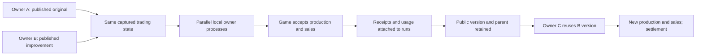

# Trading strategies: observed cycle

17 October 2026. This acceptance concerns the implementation branch.
The public site has not been deployed. No video or external model call was made.

The missing link was between a strategy run and an accepted trading action.
A run now completes only after its checked decision produces a matching game
receipt. The game pages expose the attached task graph and token accounting.

## Full local cycle



Source files: [public cycle](public-cycle.json),
[first finished game](game-1-state.json),
[third-owner game](game-2-state.json). Public fixture wallet addresses identify
separate signed processes. All test keys belong to the test driver.

| Observation | Evidence |
| --- | --- |
| Two agents work concurrently | Provider request intervals overlap across owners; A's market and risk requests also overlap. |
| Same starting state | Server captures two owners with equal initial cash and goods; both receive the immutable brief. |
| Original strategy | Two independent model checks followed by one model decision. |
| Improved strategy | A local `trade_state` extraction followed by one model decision. |
| Mandatory publication | Starting the unpublished derivative is rejected; it starts after publication. |
| Actual game consequence | Both owners produce 2 goods, then sell 2 in the next market phase. |
| Settlement | Both games finish after six rounds. Payouts plus rake equal the simulated bank. |
| Third-owner reuse | C completes B's exact published version; its public reuse count becomes 1. |
| Lost response | C's accepted production response is dropped; retry clears the pending operation without a second action or model call. |
| Persistence | All eight public runs survive server restart unchanged. |

There are four trading challenges and eight completed runs across two games.
Each challenge covers one action. The test driver advances expired phases through
the existing crank; later rounds contain no additional agent decisions. This
checks settlement and persistence, not a full-match autonomous policy.

## Token figures and outcome comparison

Observed TEST accounting per action:

| Plan | Model requests | Local tools | Synthetic input/output | Synthetic total |
| --- | ---: | ---: | ---: | ---: |
| Original | 3 | 0 | 300 / 60 | 360 |
| Improved and reused | 1 | 1 | 100 / 20 | 120 |

There were 16 local TEST provider requests and zero external model requests.
Those token counts were fixed by the test provider. They validate arithmetic and
provenance; they are not a measurement of real token savings. A local tool's zero
model tokens says nothing about compute cost or a paid tool's fee.

Both production results are +2 goods with no cash change. Their TEST counts can
be compared. In each market phase, one owner receives 22 simulated alashi and the
other 17 because they trade against a shared price curve. The API and UI show
those different outcomes without a token leader. The test does not claim the
improved strategy caused the higher sale price.

Provider usage remains owner-submitted, without provider attestation. Missing
usage is unknown and stops dependent work. Overruns and failed outputs retain
known consumption. Monetary costs are not measured.

## Failure checks

The pre-change trading acceptance returned `bad_strategy_request`; the current
end-to-end test passes. Targeted tests also check:

- Wrong owner, game or decision cannot attach an HTTP action to a run.
- Finishing without a receipt is rejected. Unknown usage blocks execution.
- A snapshot write failure restores game state, public event and strategy run.
- Reusing a game event for a different run is rejected.
- Solana receipt parsing rejects the wrong owner, units, round, stale slot,
  partial history and unconfirmed data. Its accepted fixture is an existing
  public devnet sale; no new Solana transaction was sent.
- The local signer refuses changed context or expired deadlines. An ambiguous
  signer result cannot automatically start another signer.
- A missing trading executor stops before model reservation or execution.

The native signer test and full indexer compilation require GitHub CI in this
run: local offline compilation lacks a cached `Inflector` dependency.

## Visual acceptance

The approved terrain and Degenie atlas are unchanged.
[Parallel work](desktop-parallel.png) and
[confirmed production](desktop-receipt.png) show separate stages.
[Results and reuse](results-and-reuse.png) link the +2 goods result to the
public improvement. The [phone frame](phone-map.png) keeps the entire map visible
at 390 px without horizontal overflow; detailed receipts remain readable below.

Desktop and phone-sized browser playback were inspected in motion, including
backward seeking and the receipt stage. Playback expands short events for
readability; it does not reproduce provider latency. A missing receipt creates
no successful trade journey. The existing animation checks cover routes, pose
geometry and contacts. The primary devnet page also displayed unknown model usage for an existing
game with no attached runs. Its older WebGL scene was unavailable in the test
browser; the whole-map canvas and receipt list rendered. The staging contract is in
[direction](../../../frontend/src/strategies/DIRECTION.md). No crate or cash
prop was added to the strategy map; the carried marker represents a report.

## Limits

Observed: HTTP execution with simulated balances, signed fixture owner sessions,
separate local processes, tested failure recovery and public strategy reuse.

Not validated: a fresh integrated Solana cycle, two independent humans completing
registration and browser onboarding, real provider charges, or a new viewer's
understanding. The fixture uses 300-second phases. It does not establish that two
humans can join and run their models inside the ordinary short game window.

The Solana path requires updated indexer snapshots. Its local signer checks
context before submission, but the program does not atomically enforce that
expected phase; a transaction crossing a phase boundary can fail challenge
verification. Indexer and service deployment are outside this acceptance.

The public library measures reuse by wallets, not people. One successful reuse
is a working contribution mechanism; it does not establish a network effect or
that the strategy will outperform alternatives on other tasks.

## Reproduce

```sh
npm ci --ignore-scripts --prefix tools/agent-bootstrap
ALASHI_TRADING_CYCLE_EVIDENCE_DIR=/tmp/alashi-trading-evidence \
  cargo test --locked --manifest-path arena/Cargo.toml \
  --test live_agent_e2e trading_strategies_two_processes_then_third_owner_reuse
node --test tools/agent-bootstrap/strategy-run.test.mjs tools/agent-bootstrap/alashi.test.mjs
npm --prefix frontend run build
npm --prefix frontend run check:strategies
npm --prefix frontend run check:trading
npm --prefix frontend run check:animations
```

The evidence output contains only public JSON. The separately printed runtime
path points to private fixture profiles; never publish that runtime directory.
